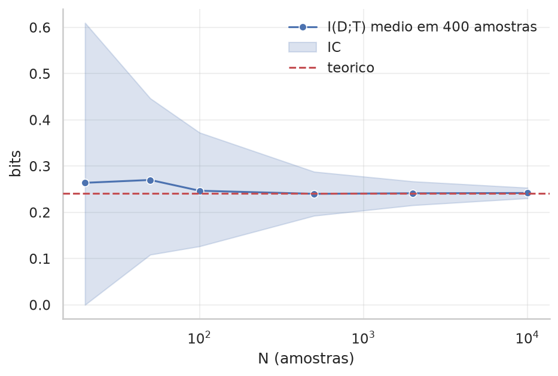
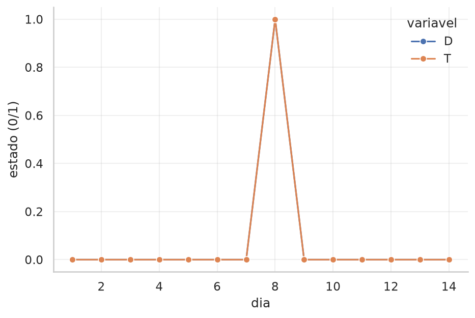
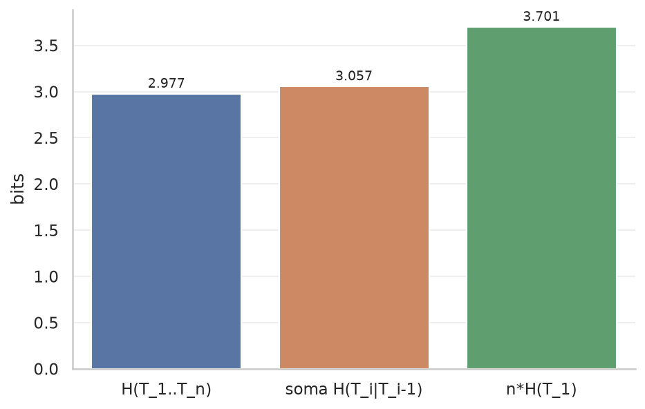
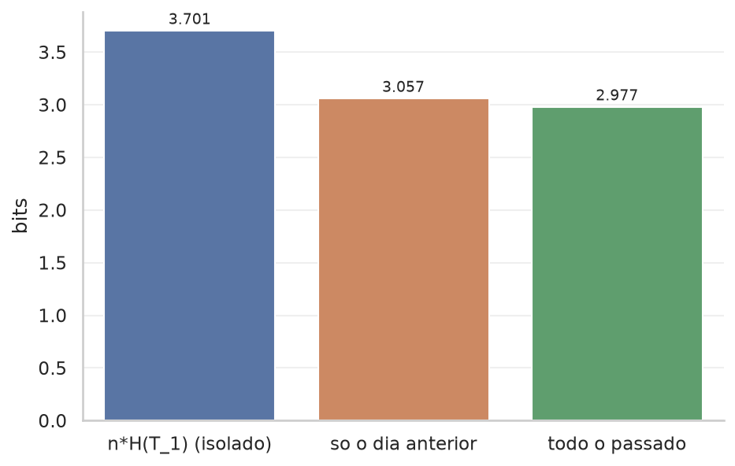
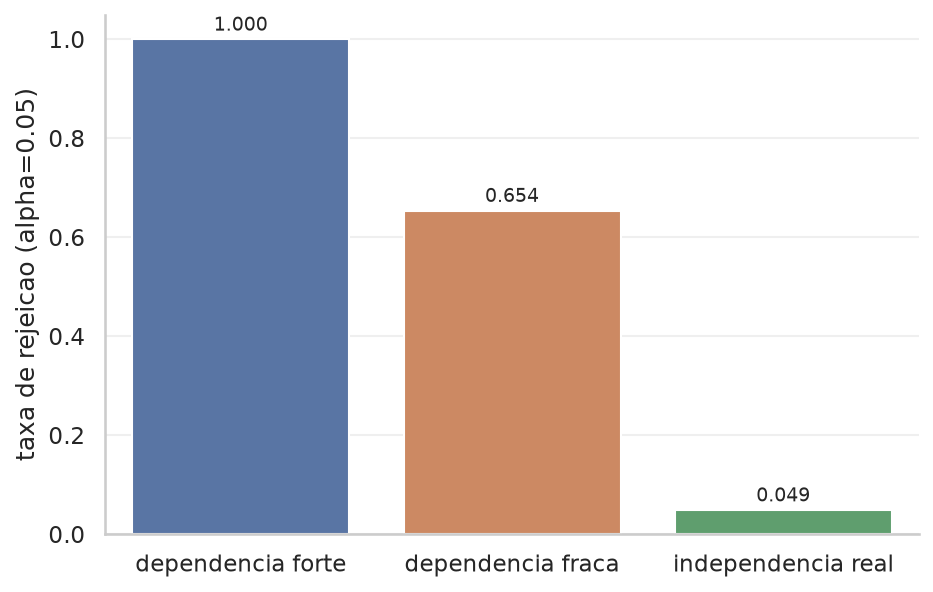
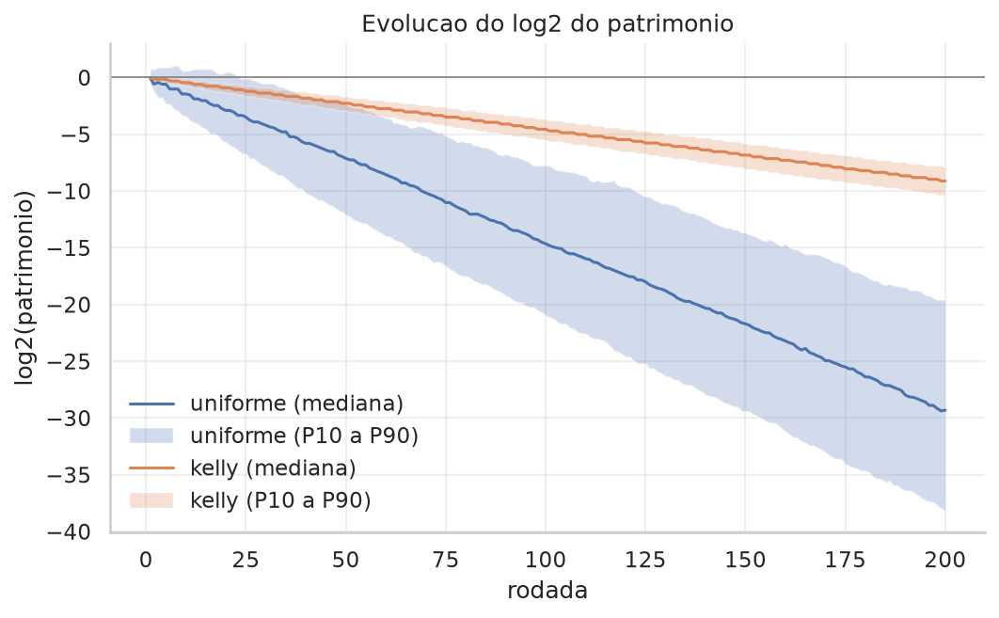
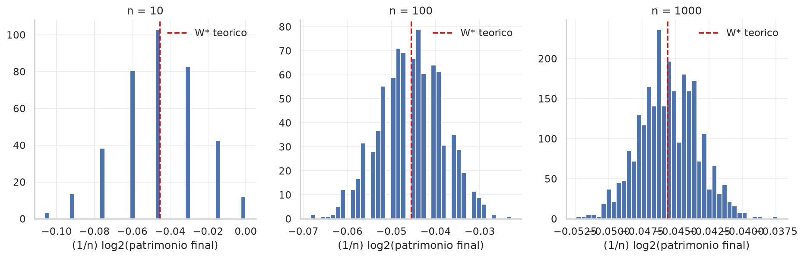

# Primeiras simulações em grupo: relatório consolidado

**MAE0552 Teoria da Informação**
Universidade de São Paulo, Instituto de Matemática e Estatística
São Paulo, outubro de 2026

## Introdução

Este relatório reúne as quatro atividades de simulação propostas em
`propostas/1_Simulacoes.pdf`. Cada tópico parte de um problema concreto, define
um modelo probabilístico, gera dados segundo esse modelo, estima quantidades de
teoria da informação "na mão" a partir dos dados e compara as estimativas com os
valores teóricos.

| Tópico | Problema | Resultado teórico testado |
| --- | --- | --- |
| 1 | Teste rápido de dengue ao longo de vários dias | Entropia, informação mútua, regra da cadeia, teste G |
| 2 | Telefone sem fio, classificador e colapso de modelo | Desigualdade de processamento de dados |
| 3 | Apostas em um campeonato de futebol | AEP, compressão e critério de Kelly |
| 4 | Link de rádio Terra-Marte transmitindo uma imagem | Capacidade do canal e teorema de Shannon |

Todos os tópicos usam as mesmas funções de entropia, entropia conjunta e
condicional, informação mútua e divergência de Kullback-Leibler, escritas a
partir das definições em `utils/info_theory.py`, sem funções prontas de
biblioteca para a quantidade de interesse. Cada tópico tem um notebook com um
passo do roteiro por seção, com semente fixa: todos os números deste relatório
saem da execução desses notebooks e as figuras são as que eles gravam em
`topicoN_.../figuras/`. A unidade de informação é sempre o bit (log na base 2).

Tabelas e figuras são numeradas por tópico (Tabela 3.2 é a segunda tabela do
Tópico 3).

---

## 1. Entropia, informação mútua e teste de independência

### 1.1 Objetivo

Decidir se um teste rápido de dengue carrega informação real sobre o estado de
saúde do paciente e quantos bits, no mínimo, são necessários para transmitir o
histórico de testes ao longo de vários dias.

### 1.2 Modelo

D é o estado de saúde (1 = infectado) e T o resultado do teste (1 = positivo).
Foram escolhidos prevalência P(D=1) = 0,08, taxa de falso positivo
P(T=1 | D=0) = 0,03 e taxa de falso negativo P(T=0 | D=1) = 0,12, o que dá a
conjunta da Tabela 1.1.

**Tabela 1.1.** Distribuição conjunta p(d, t).

| | T=0 | T=1 | total |
| --- | --- | --- | --- |
| **D=0** | 0,8924 | 0,0276 | 0,9200 |
| **D=1** | 0,0096 | 0,0704 | 0,0800 |
| **total** | 0,9020 | 0,0980 | 1,0000 |

Os valores teóricos são H(D) = 0,4022, H(T) = 0,4626, H(D,T) = 0,6234,
H(D|T) = 0,1607 e I(D;T) = 0,2414 bit.

Para a dimensão temporal (Passos 6 a 8), D segue uma cadeia de Markov de 2
estados com P(D=0→1) = a = 0,02 e P(D=1→0) = b = 0,23. A distribuição
estacionária de uma cadeia de 2 estados é [b, a]/(a+b), então escolher
b = a(1 − π)/π, com π a prevalência, faz a cadeia ter exatamente a prevalência
do modelo acima em regime. Assim a extensão temporal descreve a mesma população
dos Passos 1 a 5. A cadeia é iniciada na estacionária, não em um estado fixo.

### 1.3 Método

Geração de N pares (D, T) e estimativa das mesmas quantidades por contagem;
varredura de N com 400 amostras independentes por valor de N; entropia cruzada
e D(p‖q) para um q(D) diferente do verdadeiro; dimensão temporal pela cadeia de
Markov; teste G de independência, escrito como G = 2N ln 2 · Î(D;T).

Nos Passos 7 e 8 as quantidades comparadas também são calculadas de forma
exata. Como D é Markov e T depende apenas do D do mesmo dia, o par (D, T) é um
modelo oculto de Markov, e p(t₁…tₙ) sai do algoritmo forward somando sobre os
caminhos de D. As estimativas por contagem são então conferidas contra esse
valor exato, e não contra outra estimativa.

### 1.4 Resultados

**Passos 1 a 3: teoria contra estimativa.** Observar T reduz a incerteza sobre
D de 0,4022 para 0,1607 bit, ou seja, em 60%. Uma amostra de N = 2000 pares
reproduz bem as marginais (prevalência 0,0835 contra 0,08, positividade 0,0935
contra 0,0980), e as estimativas por contagem ficam próximas da teoria
(Tabela 1.2).

**Tabela 1.2.** Estimativas por contagem com N = 2000.

| quantidade | estimado | teórico | erro relativo (%) |
| --- | --- | --- | --- |
| H(D) | 0,4144 | 0,4022 | 3,04 |
| H(T) | 0,4480 | 0,4626 | 3,15 |
| H(D,T) | 0,6215 | 0,6234 | 0,30 |
| H(D\|T) | 0,1735 | 0,1607 | 7,92 |
| I(D;T) | 0,2409 | 0,2414 | 0,22 |

O IC bootstrap de 95% para I(D;T) é [0,2004, 0,2820] e cobre o valor teórico.
A concordância em I(D;T) é melhor que nas entropias que a compõem porque os
erros de H(T) e H(D|T) apontam para o mesmo lado e se cancelam na diferença.

**Passo 4: convergência com N.** Com 400 amostras independentes por N, a média
de Î(D;T) converge para o valor teórico e a faixa entre os percentis 10 e 90
encolhe (Tabela 1.3, Figura 1.1). A partir de N = 500 o erro da média fica
abaixo de 1%.

**Tabela 1.3.** Î(D;T) médio em 400 amostras por N.

| N | Î médio | erro relativo (%) | faixa 10% a 90% |
| --- | --- | --- | --- |
| 20 | 0,2639 | 9,3 | [0,0000, 0,6098] |
| 50 | 0,2700 | 11,8 | [0,1084, 0,4465] |
| 100 | 0,2467 | 2,2 | [0,1266, 0,3725] |
| 500 | 0,2401 | 0,6 | [0,1927, 0,2878] |
| 2000 | 0,2412 | 0,1 | [0,2154, 0,2670] |
| 10000 | 0,2418 | 0,1 | [0,2305, 0,2532] |

**Figura 1.1.** Erro de Î(D;T) em função de N.

**Passo 5: modelo errado.** Para q(D) = [0,85, 0,15], H(p,q) = 0,4347 bit
contra H(p) = 0,4022, e a diferença de 0,0325 bit coincide com
D(p‖q) = 0,0325. Codificar D com o modelo errado custa 8% a mais de bits, e esse
excesso é exatamente a divergência de Kullback-Leibler.

**Passo 6: série temporal.** A cadeia calibrada tem matriz de transição
[[0,98, 0,02], [0,23, 0,77]] e estacionária [0,92, 0,08]. A série simulada
mostra longos trechos em D=0 interrompidos por episódios curtos de infecção, com
T acompanhando D e errando ocasionalmente (Figura 1.2).

**Figura 1.2.** Série de D e T ao longo dos dias.

**Passo 7: regra da cadeia.** Para n = 8 dias e 20000 pacientes, as estimativas
por contagem ficam a menos de 1,3% dos valores exatos (Tabela 1.4).

**Tabela 1.4.** Entropia da sequência de testes, n = 8.

| quantidade | estimado | exato | erro relativo (%) |
| --- | --- | --- | --- |
| H(T₁…T₈) | 2,9391 | 2,9773 | 1,28 |
| soma H(Tᵢ\|Tᵢ₋₁) | 3,0290 | 3,0571 | 0,92 |
| 8·H(T₁) | 3,6843 | 3,7010 | 0,45 |

O ponto conceitual está na relação entre as duas primeiras linhas. T sozinho
não é uma cadeia de Markov: quem é Markov é D, e T é a observação ruidosa dele.
A regra da cadeia condiciona em todo o passado,
H(T₁…Tₙ) = Σ H(Tᵢ | T₁…Tᵢ₋₁); condicionar apenas em Tᵢ₋₁ é uma aproximação de
ordem 1 e, portanto, um limite superior. A folga entre as duas é de 0,0797 bit,
2,7% de H(T₁…T₈). É pequena, mas estrutural, e não ruído de estimação: aparece
igual no cálculo exato (Figura 1.3).

**Figura 1.3.** H(T₁…Tₙ), soma das condicionais de ordem 1 e n·H(T₁).

**Passo 8: economia de bits.** Transmitir os 8 dias como amostras independentes
custa 3,7010 bits por paciente. Usando o dia anterior como contexto o custo cai
para 3,0571 bits (economia de 0,6439 bit, 17,4%), e usando todo o passado cai
para 2,9773 bits (economia de 0,7236 bit, 19,6%). A memória de um único dia já
captura 89% de toda a economia disponível (Figura 1.4). Como a cadeia está em
regime, T₁ tem a mesma distribuição de qualquer outro dia, e a comparação mede
dependência temporal, não efeito da condição inicial.

**Figura 1.4.** Economia de bits ao usar a dependência temporal.

**Passo 9: teste G.** O teste rejeita a independência nos dois casos
(Tabela 1.5). Os 20000 pares T₂ × T₁ são um por paciente, portanto
independentes entre si.

**Tabela 1.5.** Teste G de independência.

| teste | N | Î (bits) | G | g.l. | p-valor |
| --- | --- | --- | --- | --- | --- |
| D × T | 2000 | 0,2409 | 667,95 | 1 | 2,8×10⁻¹⁴⁷ |
| T₂ × T₁ | 20000 | 0,0919 | 2547,46 | 1 | < 10⁻³⁰⁰ |

**Passo 10: poder e nível do teste.** Com N = 300 e R = 1000 repetições por
cenário, a taxa de rejeição acompanha a força da dependência e, sob
independência verdadeira, fica no nível nominal (Tabela 1.6, Figura 1.5). O erro
de Monte Carlo da taxa sob H₀ é √(0,05·0,95/1000) = 0,0069, então 0,049 está
dentro do esperado: o teste não é anticonservador nessas condições. Na
dependência fraca (I = 0,0137 bit) ele rejeita em 65% das repetições; o poder é
limitado, mas a decisão está correta na maioria delas.

**Tabela 1.6.** Taxa de rejeição a α = 0,05.

| cenário | I(D;T) teórico | taxa de rejeição |
| --- | --- | --- |
| dependência forte | 0,2414 | 1,000 |
| dependência fraca | 0,0137 | 0,654 |
| independência real | 0,0000 | 0,049 |

**Figura 1.5.** Taxa de rejeição do teste G por cenário.

### 1.5 Discussão

**Viés de amostra finita.** A informação mútua estimada por contagem é
enviesada para cima, e o viés cresce com o tamanho do alfabeto e cai com N; por
isso o Passo 4 usa a média de 400 amostras por N, e não uma amostra só. Em
N = 20 aparece um segundo efeito que o viés sozinho não explica: 21% das
amostras não contêm nenhum infectado (a probabilidade teórica é
0,92²⁰ = 19%), e nelas a tabela de contingência tem uma linha vazia e Î sai
exatamente zero. A distribuição de Î em N = 20 é bimodal, o que faz a média em
N = 20 ficar abaixo da média em N = 50, ao contrário do que se esperaria de um
viés puro. O percentil 10 igual a zero na Tabela 1.3 é a marca dessas amostras.

**Contagens esperadas pequenas.** No Passo 10 a menor contagem esperada é
N·P(D=1)·P(T=1|D=1) ≈ 300 · 0,08 · 0,88 ≈ 21, acima do mínimo prático de 5
para confiar na aproximação qui-quadrado. Com amostras bem menores a taxa de
erro tipo I deixaria de ser confiável.

**Independência das observações no teste G.** O teste pressupõe N observações
independentes, e G cresce linearmente com N. Empilhar os 7 pares consecutivos
(T₁,T₂), (T₂,T₃), … de cada paciente daria 7M "observações" que se sobrepõem
duas a duas e vêm da mesma trajetória. A estatística sairia inflada por
pseudorreplicação, por um fator da ordem de 7, sem que nenhuma informação nova
tivesse entrado. Por isso o Passo 9 usa um único par por paciente.

**Economia de bits e condição inicial.** A comparação entre o custo condicional
e n·H(T₁) só mede dependência temporal se a cadeia estiver em regime. Iniciada
fora da estacionária, H(T₁) reflete a condição inicial: partindo de um estado
uniforme a "economia" chegaria a 2,49 bits, e partindo da prevalência do
Passo 1 com uma cadeia não calibrada ela chegaria a ser negativa. Nenhum dos dois
números diria algo sobre dependência temporal.

### 1.6 Conclusão

O teste rápido carrega informação real sobre o estado de saúde:
I(D;T) = 0,2414 bit, 60% da incerteza sobre D, confirmado pelo teste G com
p-valor da ordem de 10⁻¹⁴⁷. O histórico de testes tem dependência temporal
explorável, mas o ganho é modesto: cerca de 20% dos bits, quase todo ele já
disponível olhando apenas o dia anterior. As estimativas convergem para a
teoria, com dois efeitos distintos em N pequeno (o viés para cima da informação
mútua e as amostras sem nenhum infectado), e o teste G ganha poder conforme a
dependência real fica mais forte, mantendo o erro tipo I no nível nominal
quando D e T são de fato independentes.

---

## 2. Desigualdade de processamento de dados e cadeias de Markov

### 2.1 Objetivo

Comprovar por simulação que nenhuma etapa de processamento cria informação nova
sobre a entrada: I(X;Y₁) ≥ I(X;Y₂) ≥ … ao longo de uma cadeia de Markov
X → Y₁ → Y₂ → ….

### 2.2 Modelo

- **Fonte.** X é um bit com P(X) = [0,5, 0,5], logo H(X) = 1 bit, o teto de
  I(X;Yⱼ) em toda a cadeia.
- **Telefone sem fio.** K = 5 elos, cada um um canal binário simétrico (BSC)
  com p = 0,10 no cenário base e p ∈ {0,02, 0,05, 0,10, 0,20} na varredura do
  Passo 6.
- **Cadeia inspirada em IA (Passo 7).** Duas classes equiprováveis; "imagem" de
  8 coordenadas, gaussiana com média ±s por classe, com s decaindo de 2,0 a 0,0
  ao longo das coordenadas e ruído σ = 1,5; compressão pela média de blocos de 4
  coordenadas (8 → 2); decisão pela média de classe mais próxima. As variáveis
  contínuas são projetadas na direção da diferença das médias e discretizadas
  em 10 classes por quantis para estimar as informações mútuas.
- **Colapso de modelo (Passo 8).** pmf real sobre 6 categorias,
  [0,05, 0,10, 0,15, 0,30, 0,25, 0,15]; 15 gerações; tamanho de amostra por
  geração ∈ {30, 100, 300}; 40 trajetórias independentes por tamanho.

O enunciado tem 9 passos e o notebook tem 8: os passos 7 e 8 do enunciado
(montar a cadeia rótulo → imagem → representação → predição e calcular a
informação entre o rótulo e cada estágio) estão juntos no Passo 7, porque a
verificação da DPI reamostra os estágios em conjunto; o passo 9 do enunciado é
o Passo 8.

### 2.3 Método

Propagação de N = 20000 mensagens por todos os estágios, guardando cada estágio
e não só o último; estimativa de I(X;Yⱼ) com IC bootstrap; varredura da
intensidade do ruído; cadeia rótulo → imagem → representação → predição;
gerações sucessivas medindo a distância até a distribuição real.

Duas decisões metodológicas merecem registro. A DPI afirma que a informação
cai de um estágio para o seguinte, então o que precisa de intervalo de
confiança é a queda, e não cada estágio isoladamente. A reamostragem tem de ser
pareada nos mesmos índices, porque os dois estágios vêm das mesmas amostras e
seus erros são correlacionados; comparar dois ICs que se sobrepõem não responde
à pergunta. Além disso, no Passo 8 a trajetória de cada cadeia de gerações é
aleatória e uma única trajetória não descreve o processo, por isso cada tamanho
de amostra é repetido 40 vezes.

Como a composição de k BSCs de parâmetro p é um BSC de parâmetro
pₖ = (1 − (1 − 2p)ᵏ)/2, o valor teórico de cada elo é I(X;Yₖ) = 1 − H_b(pₖ), e
as estimativas podem ser conferidas contra ele.

### 2.4 Resultados

**Passos 1 a 3.** Um bloco de exemplo X = [0,1,1,0,1] chega ao fim da cadeia
como Y₅ = [0,1,1,1,0]: dois dos cinco bits foram invertidos em algum ponto. Com
N = 20000 mensagens, as marginais empíricas de X e de todos os Yⱼ ficam entre
0,5026 e 0,5060: o canal degrada a informação sem mexer na marginal, o bit
continua equiprovável e apenas deixa de estar ligado ao original.

**Passos 4 e 5: degradação ao longo da cadeia.** I(X;Yⱼ) cai de 0,5255 bit em
Y₁ para 0,0784 bit em Y₅, sempre abaixo do teto de 1 bit (Tabela 2.1,
Figura 2.1).

**Tabela 2.1.** Informação mútua ao longo da cadeia (p = 0,10 por elo).

| elo | estimado (bits) | IC 95% | teórico |
| --- | --- | --- | --- |
| I(X;Y₁) | 0,5255 | [0,5126, 0,5387] | 0,5310 |
| I(X;Y₂) | 0,3071 | [0,2960, 0,3198] | 0,3199 |
| I(X;Y₃) | 0,1923 | [0,1828, 0,2020] | 0,1984 |
| I(X;Y₄) | 0,1248 | [0,1169, 0,1327] | 0,1247 |
| I(X;Y₅) | 0,0784 | [0,0719, 0,0851] | 0,0789 |

As diferenças sucessivas são −0,2184, −0,1148, −0,0675 e −0,0464 bit, todas
negativas, e nenhum elo apresenta aumento significativo pelo critério dos ICs
disjuntos. A queda desacelera, porque sobra cada vez menos informação para
destruir. Quatro dos cinco ICs cobrem o valor teórico; o de Y₂ fica 0,0001 bit
abaixo dele, o que é compatível com a cobertura nominal de 95%.

**Figura 2.1.** Degradação de I(X;Yⱼ) ao longo da cadeia, com IC bootstrap.

**Passo 6: intensidade do ruído.** Quanto maior o ruído por elo, mais rápida a
degradação (Tabela 2.2, Figura 2.2). Com p = 0,20, cinco elos reduzem a
informação a 0,0055 bit e o bit final praticamente não guarda relação com o
original; com p = 0,02 ainda restam 0,55 bit. A degradação é aproximadamente
geométrica, porque o efeito do ruído se compõe elo a elo. As estimativas ficam a
menos de 0,02 bit dos valores teóricos 1 − H_b(pₖ) em todas as células.

**Tabela 2.2.** I(X;Yⱼ) em bits para diferentes intensidades de ruído.

| p por elo | Y₁ | Y₂ | Y₃ | Y₄ | Y₅ |
| --- | --- | --- | --- | --- | --- |
| 0,02 | 0,8447 | 0,7486 | 0,6721 | 0,5971 | 0,5456 |
| 0,05 | 0,7121 | 0,5395 | 0,4239 | 0,3350 | 0,2614 |
| 0,10 | 0,5377 | 0,3260 | 0,1985 | 0,1228 | 0,0787 |
| 0,20 | 0,2765 | 0,0982 | 0,0376 | 0,0135 | 0,0055 |

**Figura 2.2.** Degradação de I(X;Yⱼ) para diferentes intensidades de ruído.

**Passo 7: cadeia rótulo → imagem → representação → predição.** Com N = 20000
rótulos, a informação sobre o rótulo cai a cada estágio (Tabela 2.3). O que
comprova a DPI não é a ordem dos três números, e sim o IC das quedas entre
estágios consecutivos, reamostradas de forma pareada (Tabela 2.4). Os dois
intervalos são inteiramente positivos, então as duas quedas estão resolvidas
pelos dados.

**Tabela 2.3.** Informação sobre o rótulo em cada estágio.

| estágio | I(rótulo; estágio) (bits) | IC 95% |
| --- | --- | --- |
| imagem completa | 0,8920 | [0,8846, 0,8998] |
| representação comprimida | 0,8713 | [0,8636, 0,8795] |
| predição final | 0,8104 | [0,7992, 0,8217] |

**Tabela 2.4.** Queda de informação entre estágios consecutivos.

| transição | queda (bits) | IC 95% da queda |
| --- | --- | --- |
| imagem → representação | 0,0207 | [0,0158, 0,0261] |
| representação → predição | 0,0609 | [0,0555, 0,0672] |

O classificador por distância às médias acerta 97,09% dos rótulos (o valor
teórico é 97,00%). Ele perde 0,0609 bit de informação sobre o rótulo e ainda
assim quase não erra, porque o que descarta é a informação sobre quão confiante
estava, e não sobre qual classe era.

**Passo 8: colapso de modelo.** Em 15 gerações, cada uma estimada apenas a
partir da amostra finita da geração anterior, a distância até a distribuição
real cresce, e cresce mais rápido quanto menor a amostra por geração
(Tabela 2.5, Figura 2.3).

**Tabela 2.5.** Estado das trajetórias na geração 15 (40 trajetórias por linha).

| N por geração | trajetórias com categoria extinta | categorias vivas (mediana) | variação total até p_real (mediana) | D(p_real‖p_ger) finita (mediana) |
| --- | --- | --- | --- | --- |
| 30 | 100,0% | 3 de 6 | 0,5167 | nenhuma finita |
| 100 | 77,5% | 5 de 6 | 0,3100 | 0,2113 |
| 300 | 17,5% | 6 de 6 | 0,1867 | 0,1895 |

Com 30 amostras por geração, todas as 40 trajetórias perderam pelo menos uma
categoria, e a mediana é de metade do alfabeto extinta. A divergência não tem
valor finito em nenhuma delas: não é que ela seja grande, é que o modelo passou a
atribuir probabilidade zero a eventos que acontecem. Com 300 amostras por
geração o colapso é bem mais lento, mas não desaparece.

**Figura 2.3.** Distância até p_real ao longo das gerações.

### 2.5 Discussão

**Solavancos para cima na curva.** Um aumento aparente de I(X;Yⱼ) é ruído de
estimação, não violação da DPI. O critério para decidir isso sai dos próprios
ICs, e não de uma tolerância escolhida à mão: um elo só sobe de verdade se o
piso do seu IC ficar acima do teto do IC do elo anterior. Um limiar fixo, como
"aceitar aumentos de até 0,01 bit", falharia nas duas direções: aceitaria como
ruído um aumento real em um trecho de baixa variância e reprovaria como violação
um solavanco de estimação em um trecho de alta.

**De onde vem a queda na compressão.** A projeção da imagem completa na direção
da diferença das médias é estatística suficiente para o rótulo, porque a
covariância é isotrópica; a média por blocos não é, porque o sinal varia dentro
de cada bloco (de 2,0 a 0,8 no primeiro, de 0,4 a 0,0 no segundo). Medida em
desvios-padrão do ruído, a meia distância entre as classes cai de 1,983 na
imagem para 1,881 na representação. Com a mesma discretização em 10 classes nos
dois estágios, a conta exata dá 0,8890 bit para a imagem e 0,8672 bit para a
representação, uma queda de 0,0218 bit compatível com a estimada (0,0207). A
discretização também custa informação (sem ela os valores seriam 0,9095 e
0,8866 bit), mas afeta os dois estágios quase igualmente; a queda medida é,
portanto, efeito da compressão.

**Tamanho de amostra na cadeia de IA.** Uma queda de 0,021 bit é pequena. Com
N = 2000 rótulos, o desvio-padrão dessa queda entre réplicas é da ordem de
0,009 bit, metade do efeito: a desigualdade não ficaria resolvida pelos dados, e
uma realização qualquer poderia sair com o sinal invertido. Com N = 20000 o IC
da queda é inteiramente positivo.

**Extinção de categorias no colapso de modelo.** Uma categoria que zera numa
geração nunca mais volta, porque a amostragem seguinte não tem como sorteá-la.
Isso é o próprio colapso, não um defeito da simulação. Mas D(p_real‖p_ger) fica
infinita no instante em que a primeira categoria morre, e a trajetória da
divergência se perde dali em diante. Uma simulação com uma única trajetória e
uma semente favorável reportaria uma divergência finita e não veria nada disso.
Por isso o passo acompanha também a distância de variação total, que continua
finita depois da extinção, e conta quantas categorias sobraram.

### 2.6 Conclusão

A simulação confirma a desigualdade de processamento de dados em três cenários
distintos: canal ruidoso composto, cadeia rótulo → imagem → predição e colapso
de modelo por gerações sucessivas. A informação mútua nunca cresce ao processar
dados adiante, cai mais rápido quanto maior o ruído por elo, e a queda entre
estágios só pode ser afirmada quando excede a incerteza da estimativa, o que
exigiu reamostrar a diferença e não cada estágio. No colapso de modelo, uma
cadeia de estimativas em amostra finita acumula divergência da distribuição real
geração após geração mesmo sem nenhum viés introduzido de propósito, e o
mecanismo dominante não é uma deriva suave: é a extinção irreversível de
categorias, que depende fortemente de quantos exemplos cada geração vê.

---

## 3. Compressão de dados, AEP e critério de Kelly

### 3.1 Objetivo

Verificar se o logaritmo do patrimônio de um apostador, dividido pelo número de
rodadas, se concentra em torno de um valor determinístico (AEP); comparar o
crescimento das estratégias "tudo no favorito", uniforme e Kelly; medir quanto
vale, em bits, uma informação lateral imperfeita; e quanto se perde ao apostar
com crenças erradas.

### 3.2 Fundamentação

Se X₁, …, Xₙ são i.i.d. com distribuição p, a Lei dos Grandes Números aplicada a
−log₂ p(Xᵢ) dá −(1/n) log₂ p(X₁, …, Xₙ) → H(X). Quase toda a probabilidade fica
no conjunto típico, com cerca de 2^(nH) sequências, e por isso cerca de nH bits
bastam para descrever a fonte: a taxa mínima de compressão sem perdas é a
entropia.

Com m resultados de probabilidades pᵢ, cotações oᵢ ("oᵢ para 1") e frações
apostadas bᵢ (Σ bᵢ = 1), o patrimônio é multiplicado por b(Xₖ)·o(Xₖ) a cada
rodada, e

(1/n) log₂ Sₙ → W(b,p) = Σ pᵢ log₂(bᵢ oᵢ).

A estratégia que maximiza W é b = p (Kelly), e vale
W(b,p) = W\* − D(p‖b), com W\* = Σ pᵢ log₂ oᵢ − H(p). Qualquer desvio de p custa
exatamente D(p‖b) bits por rodada, e apostar zero num resultado possível leva a
W = −∞. Se o apostador observa uma informação lateral Y e aposta b(y) = p(x|y),
o ganho de taxa é exatamente ΔW = I(X;Y) (Cover e Thomas, 2006, cap. 6).

Definindo c = 1/Σ(1/oᵢ) e os preços implícitos rᵢ = c/oᵢ, tem-se
W\* = log₂ c + D(p‖r). Se Σ(1/oᵢ) > 1 a casa embute uma margem (log₂ c < 0), e
o apostador só cresce se suas probabilidades se afastarem dos preços do mercado
o bastante para que D(p‖r) supere essa margem.

### 3.3 Modelo e método

- **Mundo simulado.** Campeonato de futebol com três resultados por rodada
  (casa, empate, visitante), p = (0,5; 0,3; 0,2) e cotações o = (2; 3; 5).
- **Escala logarítmica.** O patrimônio é acumulado em log₂ (soma dos ganhos por
  rodada), para evitar estouro numérico.
- **Vetorização.** 1000 temporadas de 200 rodadas simuladas de uma vez, como
  matriz, o que permite estimar distribuições e não apenas trajetórias
  isoladas.
- **Estratégias.** Tudo no favorito, b = (1, 0, 0); uniforme,
  b = (1/3, 1/3, 1/3); Kelly, b = p.
- **Informação lateral.** Uma dica Y com matriz p(y|x) da Tabela 3.1 é sorteada
  junto com X, e o apostador usa b(y) = p(x|y). A comparação com Kelly sem dica
  usa os mesmos sorteios de X (comparação pareada).
- **Crenças erradas.** Um apostador que acredita em q = (0,7; 0,2; 0,1) aposta
  b = q nas mesmas temporadas.
- **Cotações uniformes.** As mesmas temporadas reapostadas contra uma casa que
  paga oᵢ = 3 para todos os resultados.

**Tabela 3.1.** Matriz p(y|x) da dica usada como informação lateral.

| resultado real \\ dica | casa | empate | visitante |
| --- | --- | --- | --- |
| casa (p = 0,5) | 0,70 | 0,20 | 0,10 |
| empate (p = 0,3) | 0,15 | 0,70 | 0,15 |
| visitante (p = 0,2) | 0,10 | 0,20 | 0,70 |

### 3.4 Resultados

**Entropia da fonte e margem da casa.** H(p) = 1,4855 bits, abaixo do máximo de
log₂ 3 = 1,5850 bits para três símbolos. Uma longa sequência de resultados pode
ser descrita com cerca de 1,49 bit por rodada em vez de 1,59. Um código de
Huffman para p (comprimentos 1, 2 e 2) tem comprimento médio de 1,5 bit, apenas
0,0145 bit acima da entropia, de acordo com H ≤ L < H + 1.

Quanto às cotações, Σ 1/oᵢ = 1,0333: a casa embute uma margem de cerca de 3,3%.
Os preços implícitos r = (0,484; 0,323; 0,194) são muito próximos de p
(D(p‖r) = 0,0017 bit), então W\* = log₂ c + D(p‖r) = −0,0473 + 0,0017 =
−0,0456 bit por aposta. Neste cenário nenhuma estratégia sem informação
adicional tem crescimento positivo; o que se avalia é qual perde menos e como o
crescimento se comporta.

**Comparação entre as estratégias.**

**Tabela 3.2.** Taxa de crescimento (1/n) log₂ Sₙ após 200 rodadas, em 1000
temporadas.

| estratégia | taxa média (bits/aposta) | desvio-padrão | temporadas com log₂ S < −20 | W teórico |
| --- | --- | --- | --- | --- |
| tudo no favorito | −∞ | não se aplica | 100,0% | −∞ |
| uniforme | −0,1454 | 0,0352 | 89,1% | −0,1451 |
| Kelly | −0,0457 | 0,0049 | 0,0% | −0,0456 |

"Tudo no favorito" quebra em todas as temporadas: basta um resultado diferente
do favorito para o patrimônio zerar, e a chance de o favorito vencer 200 rodadas
seguidas é 0,5²⁰⁰ ≈ 6·10⁻⁶¹. Ainda assim, o fator esperado por rodada dessa
estratégia é 0,5 × 2 = 1: o patrimônio esperado não muda, mas é sustentado por
eventos de probabilidade desprezível. É o exemplo clássico de como a esperança
aritmética engana em processos multiplicativos, e de por que a escala
logarítmica é a correta.

A estratégia uniforme fica em −0,1454 contra W = −0,1451 teórico. A de Kelly
perde bem menos e tem variabilidade sete vezes menor entre temporadas (desvio de
0,0049 contra 0,0352). Mesmo sendo a melhor das três, ela perde capital nesse
mundo: 2^(−0,0456 × 200) ≈ 0,0018, ou seja, o patrimônio típico após 200 rodadas
é cerca de 0,2% do inicial (Figura 3.1).

**Figura 3.1.** Evolução do log₂ do patrimônio (mediana e faixa entre os
percentis 10 e 90) das estratégias uniforme e Kelly.

**A AEP em ação.** Para Kelly, pᵢoᵢ = (1; 0,9; 1), então os ganhos por rodada
são (0; −0,152; 0) e o log-patrimônio é −0,152 vezes o número de empates. A taxa
tem média W\* = −0,0456 e desvio-padrão por rodada σ = 0,0697; pelo Teorema
Central do Limite, o desvio de (1/n) log₂ Sₙ deve ser σ/√n. A Tabela 3.3
confirma a previsão, e a Figura 3.2 mostra a concentração em torno de W\*.

**Tabela 3.3.** Concentração da taxa de Kelly em torno de W\* = −0,0456 (1000
temporadas por valor de n).

| n (rodadas) | média de (1/n) log₂ S | desvio empírico | σ/√n teórico | temporadas em W\* ± 0,02 |
| --- | --- | --- | --- | --- |
| 10 | −0,0459 | 0,0218 | 0,0220 | 70,8% |
| 100 | −0,0456 | 0,0072 | 0,0070 | 99,7% |
| 1000 | −0,0455 | 0,0022 | 0,0022 | 100,0% |

**Figura 3.2.** Histogramas de (1/n) log₂(patrimônio final) para n = 10, 100 e
1000 (Kelly). A linha tracejada indica W\*.

Para n = 10 o histograma é discreto, em "pente", porque o log-patrimônio só
assume múltiplos de −0,152; a forma de sino só aparece com n maior. A média
empírica é praticamente W\* para qualquer n, e o que muda é a dispersão. Essa é
a essência da AEP: para n grande o resultado deixa de ser aleatório na escala
relevante, e o patrimônio cresce (ou decai) a uma taxa exponencial
determinística.

**Valor da informação lateral.** Com a dica da Tabela 3.1, a marginal de Y é
(0,415; 0,350; 0,235) e I(X;Y) = 0,3835 bit (H(X|Y) = 1,1020 contra
H(X) = 1,4855). A taxa de crescimento passou de −0,0458 (sem dica) para +0,3396
bit por aposta (com dica), um ganho pareado de ΔW = 0,3855 bit, com erro-padrão
de 0,0023 sobre as 1000 temporadas. O valor teórico, 0,3835, fica a 0,85
erro-padrão do estimado, e o valor absoluto previsto com dica,
W\* + I = 0,3379, também concorda com o simulado. Uma dica que reduz a incerteza
em 0,38 bit por rodada transforma um jogo perdedor em um jogo em que o
patrimônio é multiplicado, em média geométrica, por 2^0,34 ≈ 1,27 a cada rodada.

**Custo de uma crença errada.** O apostador com q = (0,7; 0,2; 0,1) cresceu a
−0,1784 bit por aposta, contra −0,0457 do apostador de Kelly nas mesmas
temporadas. Como na informação lateral, a comparação é pareada: por rodada, a
diferença entre os dois é log₂(pₓ/qₓ), e a cotação sai da conta. A perda
empírica, 0,1327 bit (erro-padrão de 0,0014), fica a 0,04 erro-padrão de
D(p‖q) = 0,1328 bit. O custo da crença errada é 2,8 vezes a margem de 0,047 bit
da casa: errar sobre o mundo sai mais caro do que a taxa que o mercado cobra.

**Cotações uniformes.** Como a margem da casa torna W\* negativo, o cenário
principal não mostra crescimento exponencial. As mesmas 1000 temporadas foram
reapostadas contra uma casa que paga oᵢ = 3 para todos os resultados, ignorando
que eles não são igualmente prováveis; nenhum sorteio novo foi feito.

**Tabela 3.4.** Mesmas temporadas, com cotações uniformes oᵢ = 3.

| estratégia | W teórico | taxa média (bits/aposta) | temporadas com log₂ S > 20 | patrimônio mediano |
| --- | --- | --- | --- | --- |
| tudo no favorito | −∞ | −∞ | 0,0% | 0 |
| uniforme | 0,0000 | 0,0000 | 0,0% | 1 |
| Kelly | 0,0995 | 0,0997 | 51,2% | ≈ 1,2·10⁶ |

Com cotações uniformes, W\* = log₂ m − H(p) = 1,5850 − 1,4855 = 0,0995 bit por
aposta, e a simulação de Kelly (0,0997) reproduz esse valor. A estratégia
uniforme fica exatamente parada, porque bᵢoᵢ = 1 em todos os resultados. O
ganho do apostador bem informado é exatamente o quanto a entropia da
distribuição real fica abaixo do máximo log₂ m: quanto mais previsível o
resultado, mais há a extrair de uma casa que não percebe o padrão. Em metade das
temporadas o patrimônio de Kelly passa de 2²⁰ ≈ 10⁶ vezes o inicial.

### 3.5 Discussão

**A AEP como fio condutor.** Compressão e apostas são manifestações do mesmo
fenômeno. Na compressão, a AEP garante que as sequências típicas têm
probabilidade próxima de 2^(−nH) e que existem cerca de 2^(nH) delas; nas
apostas, garante que (1/n) log₂ Sₙ converge para W. Nos dois casos o
comportamento médio só é relevante porque o desvio em torno dele é de ordem
1/√n, como na Tabela 3.3.

**Kelly maximiza crescimento, não valor esperado.** O fator esperado por rodada
de Kelly é 0,970, menor que o de "tudo no favorito" (1,000), e ainda assim a
primeira é incomparavelmente melhor no longo prazo. A distinção entre o valor
esperado de Sₙ e seu valor típico, medido por E[log Sₙ], é a principal lição
prática do critério.

**Informação é crescimento.** A igualdade ΔW = I(X;Y) dá à informação mútua uma
leitura operacional: bits de informação sobre o resultado convertem-se, um a
um, em bits de taxa de dobra. Do mesmo modo, D(p‖q) é o preço, em bits por
rodada, de operar com o modelo errado.

**Limitações.** (i) As cotações principais contêm margem de 3,3%, de modo que
W\* é negativo; o crescimento positivo de Kelly sem a dica aparece apenas no
cenário de cotações uniformes. (ii) Com um ativo sem risco (opção de não
apostar), a decisão ótima nesse mundo seria abster-se, alternativa que o modelo
não contempla. (iii) O apostador conhece p exatamente; na prática p seria
estimado, e o erro de estimação gera justamente o tipo de perda medido por
D(p‖q). (iv) Assumiram-se rodadas i.i.d., ausência de custos de transação e
frações de aposta arbitrariamente divisíveis. (v) A compressão foi tratada
analiticamente (entropia e comprimentos do código de Huffman, calculados no
notebook); nenhuma sequência foi de fato codificada.

### 3.6 Conclusão

A simulação reproduziu todas as previsões teóricas do tópico: a taxa de
crescimento empírica coincidiu com W(b,p) para as três estratégias, o desvio
caiu como σ/√n, o ganho da informação lateral igualou I(X;Y) (0,3855 contra
0,3835 bit), a perda por crenças erradas igualou D(p‖q) (0,1327 contra 0,1328
bit) e, com cotações uniformes, a taxa de Kelly reproduziu W\* = log₂ m − H(p)
(0,0997 contra 0,0995 bit). A Lei dos Grandes Números e o Teorema Central do
Limite, aplicados a variáveis logarítmicas, fornecem tanto o limite de
compressão quanto o critério ótimo de alocação de capital, e entropia,
divergência de Kullback-Leibler e informação mútua ganham interpretações diretas
em bits por observação.

---

## 4. Capacidade de canal e códigos corretores de erro

### 4.1 Objetivo

Testar na prática os limites do teorema da codificação de canal de Shannon num
link de rádio Terra-Marte modelado como canal binário simétrico (BSC): (i) a
taxa de erro de bit (BER) sem codificação coincide com o parâmetro p? (ii) como
se comparam repetição e Hamming(7,4) em taxa efetiva R = k/n e BER? (iii)
aumentando o bloco de repetição, a taxa de erro cai como prevê a cauda
binomial? (iv) o que acontece quando R > C?

### 4.2 Fundamentação

O BSC com parâmetro p entrega o bit enviado com probabilidade 1 − p e o inverte
com probabilidade p, de forma independente a cada uso. Sua capacidade,
C = max I(X;Y), é atingida com entrada uniforme e vale C = 1 − H_b(p), com
H_b(p) = −p log₂ p − (1 − p) log₂(1 − p).

Pelo teorema da codificação de canal, para qualquer taxa R < C existem códigos
de bloco suficientemente longos com probabilidade de erro arbitrariamente
pequena; para R > C, nenhum código consegue isso. Combinada com a teoria de
taxa-distorção, a parte inversa dá um piso concreto: nenhum código de taxa
R > C tem BER menor que H_b⁻¹(1 − C/R) (MacKay, 2003, cap. 10).

O código de repetição envia cada bit nr vezes (nr ímpar) e decodifica por
maioria; tem taxa R = 1/nr e erra exatamente quando mais da metade das cópias é
invertida, com probabilidade P(Bin(nr, p) > nr/2). O Hamming(7,4) transforma 4
bits de informação em 7 (R = 4/7) e corrige, por síndrome, qualquer erro único
dentro do bloco.

### 4.3 Modelo e método

- **Mensagem.** Uma fotografia real (2570 × 3427 pixels), em escala de cinza e
  binarizada pela média de cinza, o que dá N = 8.807.388 bits com fração de 1s de
  0,5204, próxima da entrada uniforme que atinge a capacidade.
- **Canal principal.** p = 0,10, com semente fixa.
- **Esquemas comparados.** Sem codificação (R = 1), repetição com nr = 3
  (R = 1/3) e Hamming(7,4) (R = 4/7), implementados como operações vetorizadas
  sobre vetores de bits (inversão por XOR, voto de maioria, síndrome), sem
  bibliotecas de códigos corretores. O SciPy entra só como conferência da cauda
  binomial.
- **Varreduras.** p ∈ {0,02; 0,05; 0,10; 0,15; 0,20; 0,30} para os três
  esquemas; nr de 3 a 15 com p = 0,10.
- **Cenário R > C.** Canal com p = 0,40 (C = 0,0290 bit), reconstrução visual
  da imagem recebida e varredura de nr nesse mesmo canal, para tentar de fato
  reduzir a BER.
- **Piso teórico.** Para todo esquema com R > C, a BER medida é comparada com
  H_b⁻¹(1 − C/R). A BER exata do Hamming(7,4) é calculada enumerando os 128
  padrões de erro de um bloco.

### 4.4 Resultados

**Capacidade e transmissão direta.** Para p = 0,10, H_b(p) = 0,4690 bit e
C = 0,5310 bit por uso do canal. Transmitindo os 8.807.388 bits sem proteção, a
BER foi 0,1001, contra p = 0,1000: com quase 9 milhões de bits, a fração
observada de inversões converge para a probabilidade de erro do canal.

**Comparação dos esquemas (p = 0,10).**

**Tabela 4.1.** Taxa efetiva, BER pós-decodificação e piso teórico (p = 0,10).

| esquema | R = k/n | BER | R > C | piso teórico da BER |
| --- | --- | --- | --- | --- |
| sem codificação | 1,0000 | 0,100093 | sim | 0,1000 |
| repetição (nr = 3) | 0,3333 | 0,028023 | não | 0 |
| Hamming(7,4) | 0,5714 | 0,066832 | sim | 0,0085 |

A repetição com nr = 3 é a que mais reduz erros (BER 3,6 vezes menor que sem
codificação), ao custo de três bits transmitidos por bit de informação. O
Hamming(7,4) preserva mais taxa e leva a BER a cerca de dois terços do valor sem
codificação.

A BER sozinha esconde um ponto: com C = 0,5310, o Hamming(7,4) (R = 0,5714) já
opera acima da capacidade, assim como a transmissão direta. Para R = 4/7 o piso
é 0,0085: nenhum código dessa taxa nesse canal, por mais sofisticado, chegaria
abaixo de 0,85% de bits errados, e o Hamming(7,4) fica em 6,7%. Para a
transmissão direta o piso é exatamente p, e a BER medida está em cima dele. Só a
repetição, com R = 1/3 < C, está numa taxa em que a BER pode, em princípio, ser
levada a zero.

**Efeito da intensidade do ruído.**

**Tabela 4.2.** BER pós-decodificação para diferentes valores de p.

| p | sem codificação | repetição (nr = 3) | Hamming(7,4) | Hamming(7,4) exato |
| --- | --- | --- | --- | --- |
| 0,02 | 0,019980 | 0,001164 | 0,003342 | 0,003397 |
| 0,05 | 0,050074 | 0,007234 | 0,019431 | 0,019434 |
| 0,10 | 0,099874 | 0,027964 | 0,067010 | 0,066880 |
| 0,15 | 0,149775 | 0,060816 | 0,129248 | 0,129026 |
| 0,20 | 0,199982 | 0,104136 | 0,196014 | 0,196160 |
| 0,30 | 0,299838 | 0,216050 | 0,322186 | 0,321840 |

A linha p = 0,10 vem de uma nova realização do canal, por isso difere levemente
da Tabela 4.1.

A vantagem dos códigos diminui conforme o canal fica mais ruidoso. Até
p = 0,20 o Hamming(7,4) tem BER menor que a transmissão direta, mas a vantagem
encolhe rápido (0,196 contra 0,200 em p = 0,20), e em p = 0,30 ele fica pior que
não codificar (0,322 contra 0,300). O motivo é que o código corrige apenas um
erro por bloco: num bloco com exatamente 2 erros, o decodificador sempre
"corrige" uma terceira posição. Como o Hamming(7,4) é um código perfeito, toda
síndrome não nula aponta para exatamente um bit, e a soma de duas colunas da
matriz de verificação é sempre uma terceira coluna; o bloco sai com 3 erros. A
BER exata confere com a simulação em todas as linhas e situa o cruzamento com a
transmissão direta em p = 0,2113, cerca de 1,5 erro esperado por bloco de 7 bits
(Figura 4.1). A repetição mantém a vantagem em toda a faixa testada, porque a
decisão por maioria degrada de forma mais suave.

**Figura 4.1.** BER pós-decodificação contra p, em escala logarítmica, com a
curva exata do Hamming(7,4) e o cruzamento em p = 0,2113.

**Repetição, comprimento de bloco e a promessa de Shannon.**

**Tabela 4.3.** Taxa de erro de bloco da repetição, p = 0,10 (C = 0,5310 bit).

| nr | R = 1/nr | C − R | BER empírica | BER teórica (binomial) |
| --- | --- | --- | --- | --- |
| 3 | 0,3333 | 0,1977 | 0,027955 | 0,028000 |
| 5 | 0,2000 | 0,3310 | 0,008569 | 0,008560 |
| 7 | 0,1429 | 0,3881 | 0,002748 | 0,002728 |
| 9 | 0,1111 | 0,4199 | 0,000886 | 0,000891 |
| 11 | 0,0909 | 0,4401 | 0,000285 | 0,000296 |
| 13 | 0,0769 | 0,4541 | 0,000107 | 0,000099 |
| 15 | 0,0667 | 0,4643 | 0,000032 | 0,000034 |

A taxa de erro cai de forma aproximadamente exponencial com nr (cerca de uma
ordem de grandeza a cada aumento de 4) e coincide com a cauda binomial em todas
as linhas (Figura 4.2). Isso ilustra a parte direta do teorema: aumentando o
bloco, a taxa de erro pode ser tão pequena quanto se queira, desde que R fique
abaixo de C. A queda da BER sozinha, porém, não distingue os dois regimes: no
cenário R > C abaixo, a BER da repetição também cai com nr. O que muda é se ela
pode chegar a zero.

A repetição ilustra o teorema de forma pouco eficiente: para levar a BER a
quase zero, ela leva R a quase zero também, enquanto o teorema garante códigos
que mantêm R arbitrariamente perto de C com probabilidade de erro tendendo a
zero.

**Figura 4.2.** Taxa de erro de bloco da repetição contra nr (p = 0,10),
empírica e pela cauda binomial.

**Cenário R > C.**

**Tabela 4.4.** Os três esquemas num canal muito ruidoso (p = 0,40,
C = 0,0290 bit).

| esquema | R | BER | R > C | BER aceitável (< 0,01) | piso teórico da BER |
| --- | --- | --- | --- | --- | --- |
| sem codificação | 1,0000 | 0,400243 | sim | não | 0,4000 |
| repetição (nr = 3) | 0,3333 | 0,352111 | sim | não | 0,3280 |
| Hamming(7,4) | 0,5714 | 0,420998 | sim | não | 0,3681 |

Com C = 0,0290 bit, bem abaixo da taxa de qualquer um dos três esquemas, nenhum
chega perto de uma BER aceitável: mesmo a repetição erra 35% dos bits. O
Hamming(7,4) volta a ser o pior, acima até da transmissão direta, pelo mesmo
mecanismo de correção errada, agora amplificado pelo p alto. As três BERs ficam
acima do piso teórico de suas taxas, como o teorema exige. A reconstrução
visual confirma: as imagens da varredura de nr com p = 0,10 (R < C) ficam cada
vez mais nítidas, enquanto as três do canal com p = 0,40 permanecem
irreconhecíveis (Figura 4.3).

**Figura 4.3.** Imagem original, imagens recebidas na varredura de nr com
p = 0,10 (R < C) e nos três esquemas com p = 0,40 (R > C).

O roteiro pede para tentar reduzir a taxa de erro a um nível aceitável com os
códigos disponíveis, e a repetição permite isso aumentando nr. A Tabela 4.5
mostra o resultado no canal com p = 0,40, sobre os primeiros 100.000 bits da
imagem (com BER da ordem de 1%, ainda são cerca de mil erros por ponto).

**Tabela 4.5.** Repetição no canal com p = 0,40 (C = 0,0290 bit), para nr
crescente.

| nr | R = 1/nr | R > C | BER empírica | BER teórica (binomial) | piso teórico |
| --- | --- | --- | --- | --- | --- |
| 3 | 0,3333 | sim | 0,3515 | 0,3520 | 0,3280 |
| 9 | 0,1111 | sim | 0,2677 | 0,2666 | 0,2085 |
| 19 | 0,0526 | sim | 0,1854 | 0,1861 | 0,0935 |
| 33 | 0,0303 | sim | 0,1223 | 0,1211 | 0,0045 |
| 35 | 0,0286 | não | 0,1137 | 0,1143 | 0 |
| 51 | 0,0196 | não | 0,0730 | 0,0735 | 0 |
| 75 | 0,0133 | não | 0,0399 | 0,0396 | 0 |
| 101 | 0,0099 | não | 0,0206 | 0,0209 | 0 |
| 133 | 0,0075 | não | 0,0097 | 0,0098 | 0 |
| 151 | 0,0066 | não | 0,0065 | 0,0064 | 0 |

A BER cai com nr mesmo enquanto R está acima de C: com nr = 33, o último valor
ímpar com R > C, ela já é 0,122, contra 0,352 com nr = 3. O teorema não proíbe
essa queda; proíbe que, acima de C, a BER desça abaixo do piso, e por isso ela
não pode ser levada a zero sem abrir mão da taxa. Uma BER abaixo de 1% só
aparece com nr = 133, quando R = 0,0075 é cerca de um quarto da capacidade
(Figura 4.4). Para comunicar de forma confiável nesse canal é preciso descer
abaixo de C e, com a repetição, bem abaixo. A coluna do piso mostra também o
quanto a repetição está longe do melhor código possível: com nr = 33, um código
ótimo da mesma taxa poderia ter BER de 0,0045, e a repetição tem 0,122.

**Figura 4.4.** BER da repetição contra R no canal com p = 0,40, com o piso
teórico, a capacidade C e o limiar de BER aceitável.

### 4.5 Discussão

**A capacidade como fronteira real.** As Tabelas 4.3 e 4.5 mostram os dois
lados do teorema com o mesmo código: quando R < C, aumentar o bloco reduz a BER
de forma sistemática e previsível; quando R > C, aumentar a redundância ainda
reduz a BER, mas ela nunca desce abaixo do piso teórico e só fica aceitável
depois que R cai bem abaixo de C.

**Redundância não é sinônimo de robustez.** O Hamming(7,4) é mais eficiente que
a repetição em taxa (4/7 contra 1/3), mas piora à medida que o canal fica mais
ruidoso, chegando a perder para a ausência de codificação em p = 0,30 e
p = 0,40. Isso decorre de ele corrigir um único bit por bloco: quando o número
esperado de erros por bloco (7p) passa de cerca de 1,5, a decodificação por
síndrome introduz mais erros do que remove.

**Repetição como demonstração, não como código ótimo.** A repetição reduz a taxa
de erro arbitrariamente às custas de R → 0. Testar um código que se aproxime de
C com erro baixo (por exemplo, um código de blocos aleatório com decodificação
por máxima verossimilhança) seria a extensão natural.

**Limitações.** (i) Só dois códigos simples foram testados; um código moderno
(Reed-Solomon, LDPC) permitiria observar taxas mais próximas de C com BER baixa.
(ii) O canal foi sempre o BSC; ruído em rajadas, mais realista num enlace real,
exigiria entrelaçamento antes da codificação. (iii) C foi calculada
analiticamente, sem estimar I(X;Y) a partir das amostras como conferência. (iv)
O critério de BER aceitável (< 0,01) é arbitrário; a referência não arbitrária
é o piso H_b⁻¹(1 − C/R), que vale para qualquer código e aparece nas Tabelas
4.1, 4.4 e 4.5.

### 4.6 Conclusão

A simulação reproduziu as previsões centrais do teorema da codificação de canal.
A BER sem codificação coincidiu com p. Taxa efetiva mais alta não implica maior
robustez: o Hamming(7,4) perde vantagem e acaba pior que não codificar quando o
canal fica ruidoso. A varredura do bloco de repetição confirmou, contra a cauda
binomial, que a taxa de erro pode ser reduzida arbitrariamente quando R < C,
ainda que a repetição pague com uma taxa que tende a zero. No cenário R > C,
nenhum esquema produziu comunicação confiável, todas as BERs ficaram acima do
piso teórico H_b⁻¹(1 − C/R), e a repetição só alcançou BER aceitável quando R
desceu a cerca de um quarto de C. O piso também mostrou que o Hamming(7,4) já
opera acima da capacidade no canal principal.

---

## Conclusão geral

As quatro simulações confirmaram, com dados gerados e estimativas feitas a
partir das definições, as previsões teóricas de cada tópico, e mostraram que as
mesmas poucas quantidades têm leituras operacionais diferentes conforme o
problema:

- a **entropia** é o custo mínimo de descrição: dos testes de dengue ao longo
  dos dias (Tópico 1), dos resultados de futebol (Tópico 3) e do ruído que o
  canal adiciona (Tópico 4);
- a **informação mútua** é o quanto uma observação diz sobre outra: o teste
  sobre a doença (Tópico 1), cada elo da cadeia sobre a entrada (Tópico 2), a
  dica sobre o resultado, convertida um a um em taxa de crescimento (Tópico 3),
  e o canal sobre o bit enviado, cujo máximo é a capacidade (Tópico 4);
- a **divergência de Kullback-Leibler** é o preço de usar o modelo errado: bits
  a mais na codificação (Tópico 1), afastamento acumulado no colapso de modelo
  (Tópico 2) e taxa de crescimento perdida por crenças erradas (Tópico 3).

Em todos os tópicos, a comparação com a teoria só foi conclusiva porque a
incerteza da estimativa foi medida (IC bootstrap, várias réplicas, erro de
Monte Carlo ou conferência exata), e vários dos resultados mais interessantes
apareceram justamente onde a estimativa ingênua falharia: as amostras sem
infectados em N pequeno, a pseudorreplicação no teste G, a divergência infinita
após a extinção de uma categoria e o Hamming(7,4) já operando acima da
capacidade.

## Referências

COVER, T. M.; THOMAS, J. A. *Elements of Information Theory*. 2. ed. Hoboken:
Wiley-Interscience, 2006.

HAMMING, R. W. Error detecting and error correcting codes. *Bell System
Technical Journal*, v. 29, n. 2, p. 147-160, 1950.

KELLY, J. L. A new interpretation of information rate. *Bell System Technical
Journal*, v. 35, n. 4, p. 917-926, 1956.

MACKAY, D. J. C. *Information Theory, Inference, and Learning Algorithms*.
Cambridge: Cambridge University Press, 2003.

SHANNON, C. E. A mathematical theory of communication. *Bell System Technical
Journal*, v. 27, n. 3, p. 379-423, 1948.
