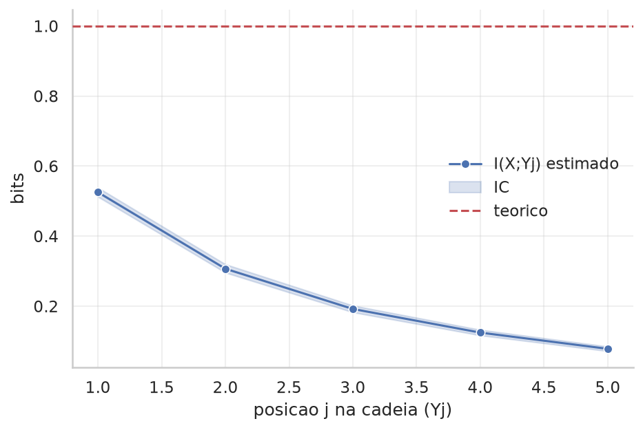
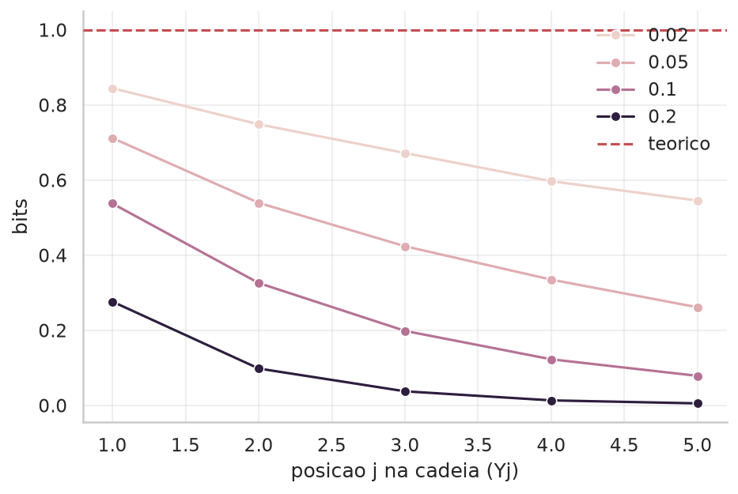
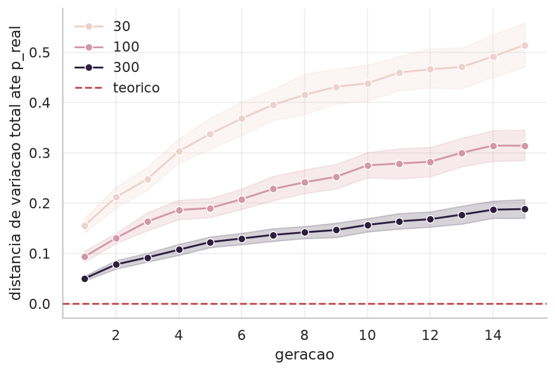

# Relatório do Tópico 2: Desigualdade de Processamento de Dados e Cadeias de Markov

## Objetivo
Comprovar por simulação que nenhuma etapa de processamento cria informação nova
sobre a entrada: I(X; Y₁) ≥ I(X; Y₂) ≥ … ao longo da cadeia.

## Modelo definido
- Fonte X: um bit, P(X) = [0,5, 0,5], logo H(X) = 1 bit — o teto de I(X; Yⱼ) em
  toda a cadeia.
- Cadeia de canais BSC: K = 5 elos, cada um com parâmetro p = 0,10 no cenário
  base, e p ∈ {0,02, 0,05, 0,10, 0,20} na varredura do Passo 6.
- Passo 7 (cadeia inspirada em IA): 2 classes equiprováveis; "imagem" de 8
  coordenadas, gaussiana com média ±SINAL por classe, SINAL decaindo de 2,0 a
  0,0 por coordenada, ruído σ = 1,5; compressão por média de blocos de 4
  coordenadas (8 → 2); decisão pela média de classe mais próxima. As projeções
  contínuas são discretizadas em 10 bins por quantis para estimar as
  informações mútuas.
- Passo 8 (colapso de modelo): pmf real sobre 6 categorias,
  [0,05, 0,10, 0,15, 0,30, 0,25, 0,15]; 15 gerações; tamanho de amostra por
  geração ∈ {30, 100, 300}; 40 trajetórias independentes por tamanho.

**Mapeamento com o enunciado.** O enunciado tem 9 passos; este notebook tem 8.
Os passos 7 e 8 do enunciado (montar a cadeia rótulo → imagem → representação →
predição, e calcular I entre o rótulo e cada estágio) estão no Passo 7 daqui,
porque a verificação da DPI reamostra os estágios em conjunto e separá-los
duplicaria a simulação. O passo 9 do enunciado (colapso de modelo) é o Passo 8
daqui.

## Método
Propagação de N = 20000 mensagens por todos os estágios, guardando cada estágio
e não só o último; estimativa de I(X; Yⱼ) para cada j com IC bootstrap pareado;
gráfico de I vs posição na cadeia; varredura da intensidade de ruído; cadeia
rótulo → imagem → representação → predição; gerações sucessivas medindo a
distância até a distribuição real.

Duas decisões metodológicas valem registro. Primeira: a DPI afirma que a
informação **cai** de um estágio para o seguinte, então o que precisa de
intervalo de confiança é a *queda*, não cada estágio isoladamente — e a
reamostragem tem de ser pareada nos mesmos índices, porque os dois estágios vêm
das mesmas amostras e seus erros são correlacionados. Comparar dois ICs que se
sobrepõem não responde à pergunta. Segunda: no Passo 8 a trajetória de cada
cadeia de gerações é aleatória, e uma única trajetória não descreve o processo;
por isso cada tamanho de amostra é repetido 40 vezes.

## Resultados
- Curva I(X; Yⱼ) decrescente, com IC bootstrap por elo.
- Efeito da intensidade do ruído na velocidade de degradação.
- I(rótulo; estágio) nas três etapas da cadeia de IA, com IC da queda entre
  etapas consecutivas.
- Distância até p_real ao longo das gerações, por tamanho de amostra, e
  frequência de extinção de categoria.

## Discussão
**Solavancos para cima na curva.** Um aumento aparente de I(X; Yⱼ) é ruído de
estimação, não violação da DPI. O critério usado para decidir isso sai dos
próprios ICs, não de uma tolerância escolhida à mão: um elo só sobe de verdade
se o piso do seu IC ficar acima do teto do IC do elo anterior, ou seja, se os
dois intervalos nem se tocarem. Um limiar fixo — digamos, "aceitar aumentos de
até 0,01 bit" — falharia nas duas direções: aceitaria como ruído um aumento real
em um trecho de baixa variância e reprovaria como violação um solavanco de
estimação em um trecho de alta.

**Tamanho de amostra na cadeia de IA.** A queda entre a imagem completa e a
representação comprimida é de apenas 0,021 bit. Com N = 2000 rótulos, o desvio
padrão dessa queda entre réplicas é da ordem de 0,009 bit, isto é, metade do
efeito: a desigualdade não ficaria resolvida pelos dados, e uma realização
qualquer poderia sair com o sinal invertido. Com N = 20000 o IC da queda é
[0,0158, 0,0261], inteiramente positivo. Vale notar que a projeção na direção
da diferença das médias não é uma perda arbitrária de informação: sob
covariância isotrópica ela é estatística suficiente para o rótulo, então
I(rótulo; projeção) = I(rótulo; vetor completo). O que de fato descarta
informação nessa estimativa é a discretização em 10 bins, e ela é aplicada da
mesma forma nos dois estágios comparados.

**Efeito do tamanho de amostra por geração.** É aqui que está o resultado mais
forte do Passo 8, e ele tem uma armadilha numérica. Uma categoria que zera numa
geração nunca mais volta — a amostragem seguinte não tem como sorteá-la. Isso
**é** o colapso, não um defeito da simulação. Mas D(p_real‖p_geração) fica +∞ no
instante em que a primeira categoria morre, porque p_geração passa a ter zero
onde p_real é positiva, e a trajetória se perde dali em diante. Com N = 300 por
geração isso acontece em 17,5% das trajetórias até a geração 15; com N = 100,
em 77,5%; com N = 30, em 100%. Uma simulação que rodasse uma única trajetória
com um seed favorável reportaria uma divergência finita e não veria nada disso.
Por isso o passo acompanha também a distância de variação total, que continua
finita e bem definida depois da extinção, e conta quantas categorias sobraram
vivas.

## Conclusão

Passo 1: com P(X)=[0,5, 0,5], H(X)=1,0000 bit. É o teto teórico de I(X;Yⱼ) ao
longo de toda a cadeia.

Passo 2: demonstração de `compose_bsc_chain` com 5 elos de p=0,10 cada. Um bloco
de exemplo (X=[0,1,1,0,1]) chega ao final da cadeia já alterado
(Y₅=[0,1,1,1,0]): dois dos cinco bits foram invertidos em algum ponto.

Passo 3: com N=20000 mensagens propagadas pelos 5 elos, as marginais empíricas
de X e de todos os Yⱼ ficam entre 0,5026 e 0,5060, coerente com um BSC simétrico
preservando P(bit=1)=0,5 em cada elo. O canal degrada a informação sem mexer na
marginal — o bit continua equiprovável, só deixa de estar ligado ao original.

Passo 4: I(X;Yⱼ) cai de 0,5255 bit em Y₁ para 0,0784 bit em Y₅, sempre abaixo do
teto H(X)=1 bit.

| elo | estimado (bits) | IC 95% |
| --- | --- | --- |
| I(X;Y₁) | 0,5255 | [0,5126, 0,5387] |
| I(X;Y₂) | 0,3071 | [0,2960, 0,3198] |
| I(X;Y₃) | 0,1923 | [0,1828, 0,2020] |
| I(X;Y₄) | 0,1248 | [0,1169, 0,1327] |
| I(X;Y₅) | 0,0784 | [0,0719, 0,0851] |

As diferenças sucessivas são −0,2184, −0,1148, −0,0675 e −0,0464 bit: todas
negativas, e nenhum elo apresenta aumento significativo pelo critério dos ICs
disjuntos. A queda também desacelera — cada elo tira menos que o anterior, em
valor absoluto, porque sobra cada vez menos informação para destruir.

Passo 5: o gráfico confirma a queda monotônica de I(X;Yⱼ) com a posição j,
dentro da faixa de incerteza do bootstrap.

Passo 6: repetindo a propagação com p = 0,02 / 0,05 / 0,10 / 0,20 por elo, quanto
maior o ruído mais rápida a degradação.

| p por elo | I(X;Y₁) | I(X;Y₂) | I(X;Y₃) | I(X;Y₄) | I(X;Y₅) |
| --- | --- | --- | --- | --- | --- |
| 0,02 | 0,8447 | 0,7486 | 0,6721 | 0,5971 | 0,5456 |
| 0,05 | 0,7121 | 0,5395 | 0,4239 | 0,3350 | 0,2614 |
| 0,10 | 0,5377 | 0,3260 | 0,1985 | 0,1228 | 0,0787 |
| 0,20 | 0,2765 | 0,0982 | 0,0376 | 0,0135 | 0,0055 |

Com p=0,20, cinco elos bastam para reduzir a informação a 0,0055 bit — na
prática, o bit final não guarda relação com o original. Com p=0,02, depois dos
mesmos cinco elos ainda restam 0,55 bit. A degradação é aproximadamente
geométrica: o efeito do ruído se compõe elo a elo, não se soma.

Passo 7: na cadeia rótulo → imagem (8 dimensões) → representação comprimida
(2 dimensões) → predição, com N=20000 rótulos:

| estágio | I(rótulo;estágio) (bits) | IC 95% |
| --- | --- | --- |
| imagem completa | 0,8920 | [0,8846, 0,8998] |
| representação comprimida | 0,8713 | [0,8636, 0,8795] |
| predição final | 0,8104 | [0,7992, 0,8217] |

O que comprova a DPI não é a ordem dos três números, e sim o IC das quedas
entre estágios consecutivos, reamostradas de forma pareada:

| transição | queda (bits) | IC 95% da queda |
| --- | --- | --- |
| imagem → representação | 0,0207 | [0,0158, 0,0261] |
| representação → predição | 0,0609 | [0,0555, 0,0672] |

Os dois intervalos são inteiramente positivos, então as duas quedas estão
resolvidas pelos dados. O classificador por distância às médias acerta 97,09%
dos rótulos: perde 0,0609 bit de informação sobre o rótulo e ainda assim
praticamente não erra — porque o que ele descarta é a informação sobre *quão*
confiante estava, não sobre qual classe era.

Passo 8: em 15 gerações, cada uma treinada só na amostra finita da geração
anterior, a distância até a distribuição real cresce, e cresce mais rápido
quanto menor a amostra por geração.

| N por geração | trajetórias com categoria extinta | categorias vivas (mediana) | variação total até p_real (mediana) | D(p_real‖p_ger) finita (mediana) |
| --- | --- | --- | --- | --- |
| 30 | 100,0% | 3 de 6 | 0,5167 | — (nenhuma finita) |
| 100 | 77,5% | 5 de 6 | 0,3100 | 0,2113 |
| 300 | 17,5% | 6 de 6 | 0,1867 | 0,1895 |

Com 30 amostras por geração, **todas** as 40 trajetórias perderam pelo menos uma
categoria em 15 gerações, e a mediana é de metade do alfabeto extinta. A KL não
tem valor finito em nenhuma delas: não é que a divergência seja grande, é que o
modelo passou a atribuir probabilidade zero a eventos que acontecem. Com 300
amostras por geração o colapso é bem mais lento, mas não desaparece — a
distância mediana já é 0,19 e 17,5% das trajetórias perderam uma categoria.

Conclusão geral: a simulação confirma a desigualdade de processamento de dados
em três cenários distintos — canal ruidoso composto, cadeia
rótulo → imagem → predição e colapso de modelo por gerações sucessivas. A
informação mútua nunca cresce ao processar dados adiante, cai mais rápido quanto
maior o ruído por elo, e a queda entre estágios só pode ser afirmada quando
excede a incerteza da estimativa, o que exigiu reamostrar a diferença e não cada
estágio. No colapso de modelo, uma cadeia de estimativas em amostra finita
acumula divergência da distribuição real geração após geração mesmo sem nenhum
viés introduzido de propósito, e o mecanismo dominante não é uma deriva suave: é
a extinção irreversível de categorias, que depende fortemente de quantos
exemplos cada geração vê.
