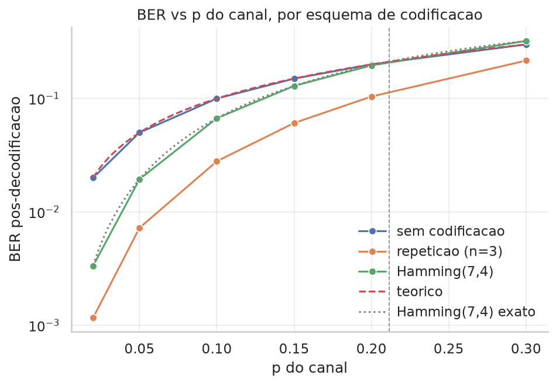
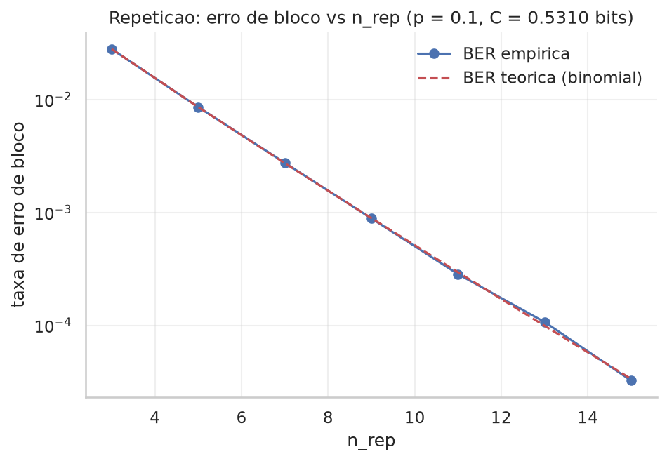
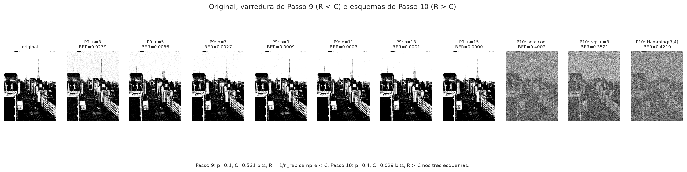
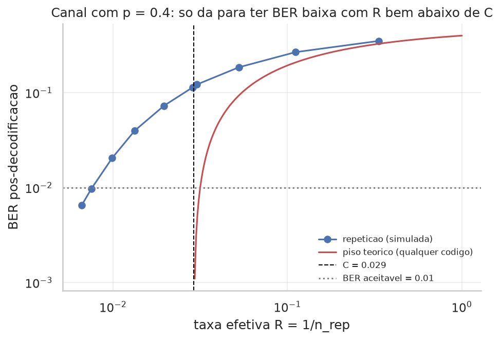

**UNIVERSIDADE DE SÃO PAULO**

Instituto de Matemática e Estatística

Departamento de Estatística

**Tópico 4**

**Capacidade de Canal e Códigos Corretores de Erro**

*Relatório de simulação em Teoria da Informação*

São Paulo

Setembro de 2026

# **1\. Introdução**

Este relatório apresenta os resultados da simulação do Tópico 4, cujo tema central é o Teorema da Codificação de Canal de Shannon: a existência de uma fronteira, a capacidade C, abaixo da qual é possível transmitir informação com taxa de erro arbitrariamente pequena, e acima da qual nenhum esquema de codificação consegue evitar uma taxa de erro afastada de zero. O cenário simulado é um elo de rádio Terra-Marte, modelado como um canal binário simétrico (BSC) com probabilidade de inversão de bit p, através do qual uma sonda espacial precisa transmitir uma imagem.

O objetivo é responder a quatro perguntas: (i) a taxa de erro de bit medida na transmissão direta, sem qualquer codificação, de fato coincide com o parâmetro p do canal? (ii) como se comparam, em termos de taxa efetiva (R \= k/n) e taxa de erro de bit (BER) pós-decodificação, um código de repetição e o código de Hamming(7,4)? (iii) aumentando o comprimento do bloco de repetição, a taxa de erro de bloco realmente cai como prevê a cauda de uma distribuição binomial, aproximando-se da promessa do teorema de Shannon? (iv) o que acontece, na prática, quando a taxa desejada R é maior que a capacidade C do canal?

# **2\. Fundamentação teórica**

## **2.1 Canal binário simétrico e capacidade**

O canal binário simétrico (BSC) com parâmetro p recebe um bit X ∈ {0,1} e devolve Y \= X com probabilidade 1 − p e Y \= 1 − X (bit invertido) com probabilidade p, de forma independente a cada uso do canal. A capacidade do canal é definida como o máximo, sobre todas as distribuições de entrada p(x), da informação mútua entre entrada e saída:

*C \= max\_{p(x)} I(X; Y)*

Para o BSC, esse máximo é atingido quando a entrada é uniforme (metade zeros, metade uns) e vale

*C \= 1 − Hb(p),  Hb(p) \= −p log₂ p − (1 − p) log₂(1 − p)*

em que Hb(p) é a entropia binária. Quando p \= 0 (canal perfeito), C \= 1 bit por uso do canal; quando p \= 0,5 (canal puramente aleatório), C \= 0: o bit recebido não carrega nenhuma informação sobre o bit enviado.

## **2.2 Teorema da codificação de canal (Shannon, 1948\)**

Para qualquer taxa de transmissão R \= k/n (bits de informação úteis por bit efetivamente transmitido) estritamente menor que C, existem esquemas de codificação, com blocos suficientemente longos, cuja probabilidade de erro pode ser tornada arbitrariamente pequena. Para R \> C, ao contrário, nenhum esquema de codificação, por mais sofisticado que seja, consegue tornar a probabilidade de erro arbitrariamente pequena: ela permanece afastada de zero. A capacidade é uma fronteira real (uma transição de fase), e não uma limitação de engenharia contornável com mais criatividade no projeto do código.

## **2.3 Redundância como proteção: repetição e Hamming(7,4)**

Um código que transforma k bits de informação em um bloco de n ≥ k bits transmitidos tem taxa R \= k/n; os n − k bits extras (redundância) permitem ao receptor detectar e corrigir erros ao custo de transmitir mais bits pela mesma quantidade de informação útil.

O código de repetição envia cada bit de informação como nr cópias idênticas (nr ímpar, para não haver empate) e decodifica por votação majoritária. Sua taxa é R \= 1/nr, e a decodificação falha exatamente quando mais da metade das nr cópias do bloco é invertida pelo canal, evento cuja probabilidade é a cauda superior de uma distribuição Binomial(nr, p) a partir da maioria:

*P(erro de bloco) \= P( Bin(nr, p) \> nr/2 )*

O código de Hamming(7,4) transforma 4 bits de informação em um bloco de 7 bits (3 deles de paridade), com taxa R \= 4/7. Sua distância mínima permite corrigir qualquer erro de um único bit dentro do bloco, através da decodificação por síndrome; blocos com dois ou mais bits invertidos são, em geral, decodificados incorretamente.

# **3\. Metodologia**

A simulação foi implementada em Python (NumPy, pandas e Matplotlib; SciPy apenas como conferência independente da cauda binomial teórica). O canal ruidoso, a codificação por repetição e a codificação/decodificação de Hamming(7,4) foram implementados diretamente como operações vetorizadas sobre vetores de bits (inversão por XOR, votação majoritária, decodificação por síndrome), sem uso de bibliotecas prontas de código corretor de erros. As principais escolhas de projeto foram:

* Mensagem. Em vez de uma sequência sintética de bits, utilizou-se uma fotografia real (2570×3427 pixels), convertida para escala de cinza e binarizada por um limiar simples (a média de cinza da própria imagem), resultando em N \= 8.807.388 bits de informação, com fração de 1s de 0,5204, próxima da entrada uniforme que atinge a capacidade do BSC. Os últimos bits (resto da divisão por 4\) foram reservados à parte, para permitir a codificação em blocos de 4 bits do Hamming(7,4) e a reconstrução visual completa da imagem ao final.

* Canal principal. p \= 0,10 (dentro do intervalo sugerido de 0,05 a 0,20 para deixar os efeitos visíveis), com semente do gerador fixa (20260902) para reprodutibilidade.

* Três esquemas comparados. (a) transmissão direta, sem codificação (R \= 1); (b) repetição com nr \= 3 (R \= 1/3); (c) Hamming(7,4) (R \= 4/7).

* Efeito do ruído. Repetição do experimento para p ∈ {0,02; 0,05; 0,10; 0,15; 0,20; 0,30}, mantendo os mesmos três esquemas.

* Promessa de Shannon. Para o canal original (p \= 0,10, C \= 0,5310 bit), variação do comprimento do bloco de repetição, nr ∈ {3, 5, 7, 9, 11, 13, 15}, com conferência da BER de bloco empírica contra a cauda binomial teórica.

* Cenário R \> C. Repetição dos três esquemas em um canal bem mais ruidoso (p \= 0,40, C \= 0,0290 bit), no qual a taxa efetiva de todos eles é maior que a capacidade, seguida de reconstrução visual da imagem recebida em cada caso e de uma varredura de nr nesse mesmo canal, para tentar de fato reduzir a BER.

* Piso teórico. Para todo esquema com R \> C, a BER medida foi comparada com o menor valor que a parte inversa do teorema permite a qualquer código daquela taxa, Hb⁻¹(1 − C/R) (MacKay, 2003, cap. 10). A BER exata do Hamming(7,4) foi calculada enumerando os 128 padrões de erro de um bloco.

# **4\. Resultados**

## **4.1 Canal e capacidade teórica**

Para p \= 0,10, a entropia binária vale Hb(p) \= 0,4690 bit, de modo que a capacidade do canal é C \= 1 − Hb(p) \= 0,5310 bit por uso do canal. Esse valor é o teto teórico contra o qual todos os esquemas de codificação serão comparados nas seções seguintes.

## **4.2 Transmissão direta (sem codificação)**

Transmitindo os 8.807.388 bits da imagem diretamente pelo canal, sem qualquer proteção, obteve-se uma taxa de erro de bit (BER) de 0,1001, praticamente idêntica ao parâmetro do canal (p \= 0,1000; diferença de apenas 0,0001). Essa coincidência é esperada: com uma amostra de quase 9 milhões de bits, a lei dos grandes números garante que a fração observada de bits invertidos converge para a probabilidade de erro do canal.

## **4.3 Comparação entre repetição e Hamming(7,4) (p \= 0,10)**

**Tabela 1 – Taxa efetiva (R) e BER pós-decodificação dos três esquemas (p \= 0,10).**

| Esquema | R \= k/n | BER | R \> C | Piso teórico da BER |
| :---: | :---: | :---: | :---: | :---: |
| Sem codificação | 1,0000 | 0,100093 | Sim | 0,1000 |
| Repetição (nr \= 3\) | 0,3333 | 0,028023 | Não | 0 |
| Hamming(7,4) | 0,5714 | 0,066832 | Sim | 0,0085 |

*Fonte: elaboração própria.*

Os dois códigos reduzem a BER em relação à transmissão direta, mas de formas diferentes. A repetição com nr \= 3 é a mais eficaz em reduzir erros (BER quase 4 vezes menor que sem codificação), só que ao custo de uma taxa efetiva bem mais baixa (R \= 1/3): são necessários 3 bits transmitidos para cada bit de informação. O Hamming(7,4) preserva mais taxa (R \= 4/7 ≈ 0,571) e ainda reduz a BER a cerca de dois terços do valor sem codificação, evidenciando um compromisso mais eficiente entre proteção e uso do canal, para este nível de ruído.

Há um ponto que a BER sozinha esconde: com p \= 0,10, a capacidade é C \= 0,5310, e o Hamming(7,4), com R \= 4/7 \= 0,5714, já opera acima dela, assim como a transmissão sem codificação (R \= 1). Para esses esquemas a parte inversa do teorema dá um piso concreto: combinada com a teoria de taxa-distorção, ela garante que nenhum código de taxa R consegue BER menor que Hb⁻¹(1 − C/R), por mais longo que seja o bloco. Para R \= 4/7 esse piso é 0,0085, ou seja, nenhum código dessa taxa nesse canal, por mais sofisticado, chegaria abaixo de 0,85% de bits errados, e o Hamming(7,4) fica em 6,7%. Para a transmissão direta o piso é exatamente p \= 0,1000, e a BER medida (0,1001) está em cima dele. Só a repetição, com R \= 1/3 \< C, está numa taxa em que a BER pode, em princípio, ser levada a zero.

## **4.4 Efeito da intensidade do ruído**

**Tabela 2 – BER pós-decodificação dos três esquemas para diferentes valores de p.**

| p | Sem codificação | Repetição (nr \= 3\) | Hamming(7,4) |
| :---: | :---: | :---: | :---: |
| 0,02 | 0,019980 | 0,001164 | 0,003342 |
| 0,05 | 0,050074 | 0,007234 | 0,019431 |
| 0,10 | 0,099874 | 0,027964 | 0,067010 |
| 0,15 | 0,149775 | 0,060816 | 0,129248 |
| 0,20 | 0,199982 | 0,104136 | 0,196014 |
| 0,30 | 0,299838 | 0,216050 | 0,322186 |

*Fonte: elaboração própria. A linha p \= 0,10 vem de uma nova realização do canal, por isso difere levemente da Tabela 1 na quarta casa decimal.*

A vantagem relativa dos códigos diminui conforme o canal fica mais ruidoso. Para p ≤ 0,20, o Hamming(7,4) sempre tem BER menor que a transmissão sem codificação, mas essa vantagem encolhe rapidamente: em p \= 0,20 a diferença já é pequena (0,196 contra 0,200). Em p \= 0,30 ocorre uma inversão notável: a BER do Hamming(7,4) (0,322) supera a da transmissão sem nenhuma proteção (0,300). A explicação é que o código corrige apenas um erro por bloco de 7 bits; quando p cresce, a probabilidade de dois ou mais bits errados no mesmo bloco deixa de ser desprezível, e num bloco com exatamente 2 erros o decodificador por síndrome sempre “corrige” uma terceira posição: como o Hamming(7,4) é um código perfeito, toda síndrome não nula aponta para exatamente um bit, e a soma de duas colunas de H é sempre uma terceira coluna. O bloco sai com 3 erros, e o resultado piora em vez de melhorar. A repetição, por sua vez, mantém a vantagem sobre os outros dois esquemas em toda a faixa de p testada, pois seu mecanismo de decisão por maioria degrada de forma mais suave.

A BER exata do Hamming(7,4), calculada enumerando os 128 padrões de erro de um bloco, confere com a simulação em todas as linhas da Tabela 2 (0,0669 contra 0,0670 em p \= 0,10, por exemplo) e situa o cruzamento com a transmissão sem codificação em p \= 0,2113, o que corresponde a cerca de 1,5 erro esperado por bloco de 7 bits.

Figura 1 – BER pós-decodificação contra p, em escala logarítmica, com a curva exata do Hamming(7,4) e o ponto de cruzamento em p = 0,2113.

*Fonte: elaboração própria.*

## **4.5 Repetição, comprimento de bloco e a promessa de Shannon**

**Tabela 3 – BER de bloco da repetição para diferentes nr, com p \= 0,10 fixo (C \= 0,5310 bit).**

| nr | R \= 1/nr | C − R | BER empírica | BER teórica (binomial) |
| :---: | :---: | :---: | :---: | :---: |
| 3 | 0,3333 | 0,1977 | 0,027955 | 0,028000 |
| 5 | 0,2000 | 0,3310 | 0,008569 | 0,008560 |
| 7 | 0,1429 | 0,3881 | 0,002748 | 0,002728 |
| 9 | 0,1111 | 0,4199 | 0,000886 | 0,000891 |
| 11 | 0,0909 | 0,4401 | 0,000285 | 0,000296 |
| 13 | 0,0769 | 0,4541 | 0,000107 | 0,000099 |
| 15 | 0,0667 | 0,4643 | 0,000032 | 0,000034 |

*Fonte: elaboração própria.*

A BER de bloco da repetição cai de forma aproximadamente exponencial conforme nr cresce (aproximadamente uma ordem de grandeza a cada aumento de 4 em nr), e a BER empírica coincide com a cauda binomial teórica em todas as linhas da tabela, até a quarta casa decimal. Esse resultado confirma, de forma qualitativa, a parte “construtiva” do teorema de Shannon: aumentando o comprimento do bloco (aqui, o número de repetições), a taxa de erro pode ser tornada tão pequena quanto se queira, sempre que a taxa efetiva do código permaneça abaixo da capacidade. De fato, R \= 1/nr está sempre abaixo de C \= 0,531 nesta tabela. A queda da BER sozinha, porém, não é o que distingue os dois regimes do teorema: na Seção 4.6 a BER da repetição também cai com nr num canal em que R ainda está acima de C. O que muda é se ela pode chegar a zero.

Vale notar, porém, que a repetição ilustra o teorema de forma pouco eficiente: para reduzir a BER de bloco a quase zero, sua taxa efetiva R precisa cair para próximo de zero também, ao passo que o teorema de Shannon garante a existência de códigos que mantêm R arbitrariamente próximo da capacidade C ao mesmo tempo em que a probabilidade de erro tende a zero. A repetição é, portanto, um exemplo simples e transparente da direção “existe código que funciona quando R \< C”, mas está longe de ser um código eficiente nesse sentido mais forte.

Figura 2 – Taxa de erro de bloco da repetição contra nr (p = 0,10), empírica e pela cauda binomial.

*Fonte: elaboração própria.*

## **4.6 Cenário R \> C: o limite intransponível**

**Tabela 4 – Os três esquemas em um canal muito ruidoso (p \= 0,40, C \= 0,0290 bit).**

| Esquema | R | BER | R \> C | BER aceitável (\< 0,01) | Piso teórico da BER |
| :---: | :---: | :---: | :---: | :---: | :---: |
| Sem codificação | 1,0000 | 0,400243 | Sim | Não | 0,4000 |
| Repetição (nr \= 3\) | 0,3333 | 0,352111 | Sim | Não | 0,3280 |
| Hamming(7,4) | 0,5714 | 0,420998 | Sim | Não | 0,3681 |

*Fonte: elaboração própria.*

Com p \= 0,40, a capacidade cai para C \= 0,0290 bit por uso do canal, bem abaixo da taxa efetiva de qualquer um dos três esquemas testados. Como previsto pelo teorema, nenhum deles chega perto de uma BER aceitável: mesmo a repetição, a mais protetora dos três nesse cenário, ainda erra 35% dos bits. O Hamming(7,4) é, mais uma vez, o pior desempenho entre os três (BER \= 0,421, superando inclusive a transmissão sem codificação), pelo mesmo mecanismo de miscorreção discutido na Seção 4.4, agora fortemente amplificado pelo alto valor de p. As três BERs medidas ficam acima do piso teórico de suas taxas (0,4000, 0,3280 e 0,3681), como o teorema exige.

A reconstrução visual da imagem confirma esse resultado de forma direta: a varredura de nr do Passo 9 (canal original, R \< C) produz imagens cada vez mais nítidas conforme nr cresce, ao passo que as três imagens reconstruídas a partir do canal ruidoso do Passo 10 (R \> C) permanecem irreconhecíveis (um ruído essencialmente uniforme), independentemente de qual dos três esquemas de codificação foi usado. Nenhuma quantidade de engenhosidade na codificação, dentre as testadas, consegue contornar o fato de a taxa desejada exceder a capacidade do canal.

Figura 3 – Imagem original, imagens recebidas na varredura de nr do Passo 9 (R < C) e nos três esquemas do Passo 10 (R > C).

*Fonte: elaboração própria.*

O roteiro, porém, pede para *tentar* reduzir a taxa de erro a um nível aceitável com os códigos disponíveis, e a repetição permite fazer isso aumentando nr. A Tabela 5 mostra o resultado no mesmo canal com p = 0,40, sobre os primeiros 100.000 bits da imagem (com BER da ordem de 1%, isso ainda dá cerca de mil erros por ponto), com a cauda binomial como conferência.

**Tabela 5 – Repetição no canal com p = 0,40 (C = 0,0290 bit), para nr crescente.**

| nr | R = 1/nr | R > C | BER empírica | BER teórica (binomial) | Piso teórico |
| :---: | :---: | :---: | :---: | :---: | :---: |
| 3 | 0,3333 | Sim | 0,3515 | 0,3520 | 0,3280 |
| 9 | 0,1111 | Sim | 0,2677 | 0,2666 | 0,2085 |
| 19 | 0,0526 | Sim | 0,1854 | 0,1861 | 0,0935 |
| 33 | 0,0303 | Sim | 0,1223 | 0,1211 | 0,0045 |
| 35 | 0,0286 | Não | 0,1137 | 0,1143 | 0 |
| 51 | 0,0196 | Não | 0,0730 | 0,0735 | 0 |
| 75 | 0,0133 | Não | 0,0399 | 0,0396 | 0 |
| 101 | 0,0099 | Não | 0,0206 | 0,0209 | 0 |
| 133 | 0,0075 | Não | 0,0097 | 0,0098 | 0 |
| 151 | 0,0066 | Não | 0,0065 | 0,0064 | 0 |

*Fonte: elaboração própria.*

A BER cai à medida que nr cresce mesmo enquanto R ainda está acima de C: com nr = 33, o último valor ímpar com R > C, ela já é 0,121, contra 0,352 com nr = 3. O teorema não proíbe essa queda. O que ele proíbe é que, acima de C, a BER desça abaixo do piso, e por isso ela não pode ser levada a zero sem abrir mão da taxa. Uma BER abaixo de 1% só aparece com nr = 133, quando R = 0,0075 já é cerca de um quarto da capacidade. É exatamente a fronteira que o teorema descreve: para comunicar de forma confiável nesse canal é preciso descer abaixo de C, e, com a repetição, bem abaixo. A coluna do piso mostra também o quanto a repetição está longe do melhor código possível: com nr = 33, um código ótimo da mesma taxa poderia ter BER de 0,0045, e a repetição tem 0,121.

Figura 4 – BER da repetição contra a taxa efetiva R no canal com p = 0,40, com o piso teórico de qualquer código, a capacidade C e o limiar de BER aceitável.

*Fonte: elaboração própria.*

# **5\. Discussão**

A capacidade como fronteira real. Os resultados das Seções 4.5 e 4.6 ilustram os dois lados do teorema de Shannon com o mesmo código de repetição e o mesmo par de canais: quando R \< C, aumentar o comprimento do bloco reduz a BER de forma sistemática e previsível (cauda binomial); quando R \> C, aumentar a redundância ainda reduz a BER, mas ela nunca desce abaixo do piso teórico e só fica aceitável depois que R cai bem abaixo de C. A capacidade não é, portanto, uma limitação de engenharia contornável com mais criatividade, mas uma transição de fase matemática.

Redundância não é sinônimo de robustez. Um resultado talvez contraintuitivo da Seção 4.4 é que o Hamming(7,4), apesar de ser um código estritamente “melhor” que a repetição do ponto de vista de eficiência de taxa (R \= 4/7 contra R \= 1/3), tem desempenho pior à medida que o canal fica mais ruidoso, chegando a perder até para a ausência total de codificação em p \= 0,30 e p \= 0,40. Isso decorre de sua capacidade de correção ser limitada a um único bit por bloco: quando o número esperado de erros por bloco de 7 bits (7p) passa de cerca de 1,5 (p ≈ 0,21, pela conta exata), a decodificação por síndrome passa a “corrigir” a posição errada com frequência crescente, introduzindo mais erros do que remove. A repetição, com sua decisão por maioria simples, degrada de forma mais gradual e continua sendo o esquema mais protetor entre os dois em todo o intervalo de p testado, embora ao custo de uma taxa efetiva muito menor.

Repetição como demonstração didática, não como código ótimo. A Tabela 3 confirma que o esquema de repetição consegue, de fato, reduzir a taxa de erro arbitrariamente ao aumentar nr, mas fazendo R tender a zero. O teorema de Shannon promete algo mais forte: existem códigos (tipicamente aleatórios ou estruturados de blocos longos, não a simples repetição) capazes de manter R arbitrariamente próximo de C com probabilidade de erro tendendo a zero. Testar um código com essa propriedade (por exemplo, um código de blocos aleatório com decodificação por máxima verossimilhança, mesmo que computacionalmente caro) seria uma extensão natural deste trabalho.

Limitações e possíveis extensões. (i) Apenas dois códigos determinísticos e de complexidade baixa foram testados; a comparação com um código mais moderno (por exemplo, um código de Reed–Solomon ou LDPC) permitiria observar taxas mais próximas de C com BER baixa. (ii) O canal foi sempre o BSC simétrico; canais com ruído dependente do tempo (rajadas de erro, mais realistas em enlaces reais Terra-Marte) exigiriam entrelaçamento (interleaving) antes da codificação. (iii) A capacidade C foi calculada apenas analiticamente; não se estimou I(X;Y) diretamente a partir das amostras simuladas como conferência independente, o que teria sido possível reaproveitando as funções de informação mútua construídas nos tópicos anteriores. (iv) O critério de “BER aceitável” (\< 0,01) na Seção 4.6 é arbitrário, escolhido apenas para tornar a conclusão mais concreta; a referência não arbitrária é o piso teórico Hb⁻¹(1 − C/R), que vale para qualquer código e aparece nas Tabelas 1, 4 e 5.

# **6\. Conclusão**

A simulação reproduziu com boa fidelidade as previsões centrais do teorema da codificação de canal de Shannon. A taxa de erro sem codificação coincidiu com o parâmetro p do canal, como previsto pela lei dos grandes números. A comparação entre repetição e Hamming(7,4) mostrou que taxa efetiva mais alta não implica maior robustez: o Hamming(7,4) perde vantagem, e eventualmente piora em relação à ausência de codificação, à medida que o canal fica mais ruidoso e sua capacidade de corrigir apenas um erro por bloco é excedida com frequência crescente. A varredura do comprimento do bloco de repetição confirmou, com precisão de quarta casa decimal contra a cauda binomial teórica, que a taxa de erro de bloco pode ser reduzida arbitrariamente quando a taxa efetiva do código permanece abaixo da capacidade do canal, ainda que a repetição simples pague por isso com uma taxa que tende a zero. Por fim, o cenário com R \> C confirmou, tanto nas taxas de erro medidas quanto na reconstrução visual da imagem transmitida, que nenhum dos esquemas testados consegue produzir uma comunicação minimamente confiável quando a taxa desejada excede a capacidade do canal, ilustrando de forma concreta a natureza de fronteira, e não de mera dificuldade de engenharia, da capacidade de Shannon. O piso teórico Hb⁻¹(1 − C/R) mostrou ainda que o Hamming(7,4) já opera acima da capacidade no canal principal, que todas as BERs medidas acima de C respeitam esse limite, e que no canal ruidoso a repetição só alcança BER aceitável quando R desce a cerca de um quarto de C.

# **Referências**

COVER, T. M.; THOMAS, J. A. Elements of Information Theory. 2\. ed. Hoboken: Wiley-Interscience, 2006\. (Cap. 7.)

HAMMING, R. W. Error detecting and error correcting codes. Bell System Technical Journal, v. 29, n. 2, p. 147–160, 1950\.

SHANNON, C. E. A mathematical theory of communication. Bell System Technical Journal, v. 27, n. 3, p. 379–423, 1948\.

MACKAY, D. J. C. Information Theory, Inference, and Learning Algorithms. Cambridge: Cambridge University Press, 2003\.
